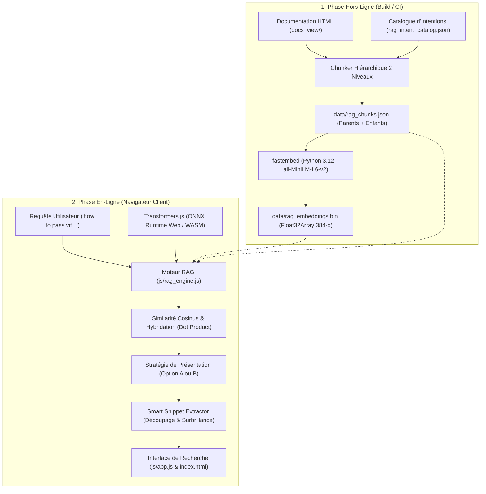
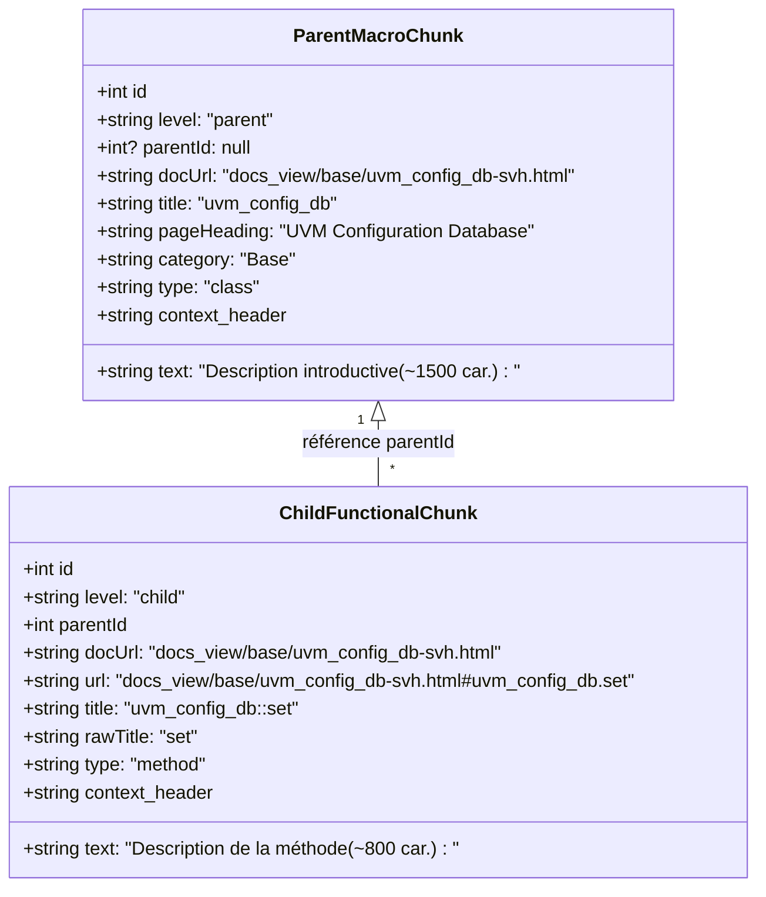

# Spécification Technique & Architecture Détaillée du Moteur RAG UVM 1.2

Ce document constitue la spécification de conception, d'architecture et d'implémentation du système de **Recherche en Langage Naturel & RAG (Retrieval-Augmented Generation) Vectoriel Client-Side** pour la documentation UVM 1.2.

---

## 1. Contexte & Objectifs

### 1.1 Contexte
Le portail documentaire UVM 1.2 est un site web statique moderne déployé sur **GitHub Pages**, offrant une navigation unifiée entre la documentation générée (NaturalDocs) et le code source SystemVerilog (Prism.js) via un panneau scindé (*Split View*).

### 1.2 Limitations de la Recherche Classique (Symbolique & Lexicale)
La recherche historique par index textuel (`js/search_data.js`) excelle sur les noms de symboles exacts (`uvm_driver`, `set_drain_time`, `UVM_MEDIUM`), mais échoue face aux requêtes des ingénieurs en vérification :
- **Fossé de vocabulaire (*Vocabulary Gap*)** : Les ingénieurs emploient des termes pratiques du métier (*"pass virtual interface vif"*, *"end of test"*, *"broadcast to scoreboard"*) qui ne figurent pas littéralement dans la spécification IEEE abstraite.
- **Requêtes conceptuelles et interrogatives** : *"how to synchronize sequences"*, *"difference between create and new"*.
- **Synonymes et acronymes** : `vif` $\leftrightarrow$ `virtual interface` $\leftrightarrow$ `uvm_config_db`.

### 1.3 Objectifs & Contraintes
1. **100% Client-Side & Hors-Ligne** : Aucune API payante (OpenAI, Gemini...), aucun serveur backend, aucune fuite de données (confidentialité IP/DUT absolue).
2. **Empreinte Ressource Contrôlée** : Modèle d'inférence compact ($\le 25\text{ Mo}$), mémoire RAM volatile libérée à l'inactivité, persistance en cache navigateur (`Cache API`).
3. **Performance Temps Réel** : Inférence de la requête $< 150\text{ ms}$ (WASM/ONNX), comparaison vectorielle $< 5\text{ ms}$ sur l'ensemble de la base.
4. **Intégration CI/CD Transparente** : Génération automatique des vecteurs lors du déploiement GitHub Actions (`deploy.yml`), sans quota GitHub Copilot.

---

## 2. Architecture Globale du Système



---

## 3. Le Découpage Hiérarchique à 2 Niveaux (Parent-Child)

### 3.1 Pourquoi le RAG Plat Échouait
Dans la version initiale (RAG plat monocouche) :
- **2 564 micro-segments** générés avec une moyenne de 50 mots par fragment.
- Les méthodes utilitaires d'une ligne (`display_objections`, `abstract`) perdaient toute la sémantique de leur classe mère.
- **Pollution par les Release Notes** : 113 fragments issus de `relnotes-txt.html` répondaient à des mots-clés d'erreurs historiques et saturaient les résultats.
- **Duplication massive** : Les 5 premiers résultats d'une recherche pointaient souvent vers 5 sous-sections de la même page (`uvm_config_db`).

### 3.2 Structure Hiérarchique à 2 Niveaux
La documentation UVM 1.2 est naturellement bipartie : un fichier HTML représente un composant ou un guide d'architecture, et les sections internes représentent ses méthodes et configurations.



1. **Niveau 1 : Macro-Segments Parent (Classes & Guides)** :
   - Nombre : **145 parents** (1 par fichier documentaire).
   - Rôle : Représente l'architecture globale, la hiérarchie et le rôle principal du composant.
   - Longueur : jusqu'à 1 500 caractères d'introduction substantielle (excluant les tables de sommaires).
2. **Niveau 2 : Chunks Fonctionnels Enfants (Méthodes, Tâches, Macros)** :
   - Nombre : **1 977 enfants**.
   - Rôle : Contient le prototype, les arguments et l'explication précise de chaque méthode ou cas d'usage.
   - Longueur : 60 à 1 200 caractères avec son ancre HTML dédiée (`#uvm_config_db.set`).
3. **Filtrage Énergique du Bruit** :
   - `relnotes-txt.html` est **strictement exclu**.
   - Les blocs `<!--START_ND_SUMMARY-->...<!--END_ND_SUMMARY-->` et tables `<div class="Summary">` sont éliminés avant tokenisation.

---

## 4. Catalogue d'Intention Métier (`config/rag_intent_catalog.json`)

### 4.1 Concept de Contextual Retrieval
Pour combler le *Vocabulary Gap* sans altérer l'intégrité du texte original affiché à l'utilisateur, des intentions d'ingénierie et des synonymes sont injectés **uniquement dans l'en-tête vectoriel** (`context_header`) :

$$\text{Texte Vectorisé} = \text{context\_header} + \text{ " " } + \text{text}$$

### 4.2 Schéma & Exemple
```json
{
  "patterns": ["uvm_config_db", "config_db"],
  "intents": [
    "pass virtual interface vif to driver monitor testbench components",
    "hierarchical configuration database set and get mechanism",
    "sharing configuration objects parameters across uvm hierarchy",
    "retrieve virtual interface in build phase"
  ],
  "synonyms": ["vif", "virtual interface", "config_db", "set", "get", "build_phase", "scope"]
}
```

Lors du calcul de l'embedding pour `uvm_config_db::set`, l'en-tête généré est :
```text
[UVM 1.2 Method] [uvm_config_db::set] Class: uvm_config_db. Category: Base. [Intents: pass virtual interface vif to driver monitor testbench components, hierarchical configuration database set and get mechanism] [Keywords: vif, virtual interface, config_db, set, get, build_phase]
```
Le modèle d'embedding projette ainsi ce vecteur directement au voisinage sémantique de la question *"how to pass vif to driver with config db"*.

---

## 5. Modèles d'Embedding & Formats Binaires

### 5.1 Catalogue Modulaire (`config/rag_models.json`)
Permet l'ajout ou le retrait immédiat de modèles sans modification du code source JavaScript :

| Modèle | Identifiant Hugging Face | Poids Téléchargé | RAM Requise | Précision | Vitesse |
| :--- | :--- | :---: | :---: | :---: | :---: |
| **MiniLM-L6 (Par Défaut)** | `Xenova/all-MiniLM-L6-v2` | 23 Mo | ~60 Mo | ⭐⭐⭐⭐ | ⭐⭐⭐⭐⭐ |
| **BGE-Small-EN** | `Xenova/bge-small-en-v1.5` | 33 Mo | ~85 Mo | ⭐⭐⭐⭐⭐ | ⭐⭐⭐⭐ |
| **BGE-Micro** | `TaylorAI/bge-micro-v2` | 14 Mo | ~35 Mo | ⭐⭐⭐ | ⭐⭐⭐⭐⭐ |

### 5.2 Formats de Données (`data/`)
- `data/rag_chunks.json` (2,3 Mo) : Tableau d'objets JSON contenant la hiérarchie (`id`, `level`, `parentId`), les métadonnées (`docUrl`, `url`, `anchor`, `category`), les titres et le texte propre.
- `data/rag_embeddings.bin` (3,18 Mo) : Matrice binaire plate contiguë de $N \times 384$ flottants 32-bit (`Float32Array`), où $N = 2\,122$.

---

## 6. Moteur Vectoriel Client-Side (`js/rag_engine.js`)

### 6.1 Inférence Vectorielle & Similarité Cosinus
1. La requête utilisateur $Q$ est vectorisée en direct par **Transformers.js** dans un worker ou sur le thread principal en WASM / ONNX Runtime :
   $$\vec{q} = \text{Embed}(Q), \quad \|\vec{q}\|_2 = 1$$
2. Les vecteurs stockés $\vec{d}_i$ étant déjà normalisés $\|\vec{d}_i\|_2 = 1$, la similarité cosinus équivaut au produit scalaire direct :
   $$\text{Score}_{\text{vectoriel}}(i) = \vec{q} \cdot \vec{d}_i = \sum_{k=1}^{384} q_k \cdot d_{i,k}$$
   Sur un CPU standard, cette opération sur $2\,122$ vecteurs s'exécute en **moins de 2 millisecondes**.

### 6.2 Recherche Hybride (RRF / Lexical + Vectoriel)
Pour garantir qu'une faute de frappe ou une recherche de nom exact (`uvm_agent`) ne soit pas surclassée par une page conceptuelle générale :
$$\text{Score}_{\text{final}} = 0{,}70 \cdot \text{Score}_{\text{vectoriel}} + 0{,}30 \cdot \text{Score}_{\text{lexical}}$$
Le score lexical attribue des bonus pondérés selon la présence exacte des tokens de la requête dans le titre de la classe ($+10$), le nom de la méthode ($+8$), et le corps du texte ($+1$).

### 6.3 Stratégies de Présentation

#### Option A : Consolidation par Document/Classe (Activée par défaut)
1. Les résultats individuels sont regroupés par `docUrl`.
2. Pour chaque document :
   - On identifie le Parent ($P$) et le meilleur Enfant ($C$).
   - On calcule le score combiné :
     $$\text{Score}_{\text{doc}} = 0{,}70 \cdot \max(S_P, S_C) + 0{,}30 \cdot \min(S_P, S_C)$$
   - Si un enfant spécifique a déclenché le match, un badge dédié est affiché : `🎯 Section: <nom_méthode>` et le lien pointe directement sur son ancre HTML.
3. Résultat : Chaque carte représente une classe unique, sans jamais doubler un fichier dans les résultats.

#### Option B : Liste Mixte Dé-dupliquée (Bascule via Paramètres `⚙️`)
1. Les segments (parents ou enfants) sont triés individuellement par score décroissant.
2. Un ensemble `seenDocs` mémorise les URLs de documents déjà ajoutées.
3. Si un second segment appartenant au même document apparaît, il est rejeté. Chaque page documentaire apparaît au maximum une fois.

### 6.4 Smart Snippet Extractor
Au lieu d'afficher les premiers mots génériques du document :
1. Le texte du segment gagnant est découpé en phrases selon la regex `/(?<=[.!?])\s+(?=[A-Z0-9`])/`.
2. Chaque phrase est notée en fonction de la concentration de mots-clés de la requête.
3. Les 1 à 2 phrases les plus pertinentes sont sélectionnées, réordonnées selon le flux naturel du document, tronquées proprement à 260 caractères et enrichies de balises `<mark class="rag-highlight">` pour la mise en valeur visuelle.

### 6.5 Gestion de la RAM & Cache
- **Économie de RAM** : Le modèle ONNX pèse ~60 Mo en mémoire vive. Dès que la modale de recherche est fermée ou après 3 minutes d'inactivité (`idleTimer`), la référence `this.pipeline` est réinitialisée à `null` et la mémoire est immédiatement libérée par le Garbage Collector du navigateur.
- **Cache Persistant** : Les fichiers du modèle ONNX sont stockés via la `Cache API` du navigateur. Les visites ultérieures ne téléchargent aucun octet sur le réseau.
- **Purge Manuelle** : Le bouton *Vider le cache IA* dans la modale de configuration supprime tous les caches liés à `transformers / onnx`.

---

## 7. Automatisation CI/CD (`.github/workflows/deploy.yml`)

Lors de chaque `push` sur la branche `main` :
1. **Runner Ubuntu Gratuit** (`ubuntu-latest`).
2. Installation de `fastembed` via `pip install fastembed`.
3. Exécution de `python scripts/build_docs.py` (construction de la doc et de `js/search_data.js`).
4. Exécution de `python scripts/build_rag_embeddings.py` (extraction hiérarchique et vectorisation en ~15 secondes).
5. Vérification d'intégrité automatisée (`test -f data/rag_chunks.json`, `test -f data/rag_embeddings.bin`).
6. Déploiement statique sur GitHub Pages.

**Impact Quotas** : Zéro coût, zéro consommation de crédits Copilot ou API LLM.

---

## 8. Résultats du Benchmark de Validation

Tests exécutés sur les requêtes d'ingénierie types :

| Requête Type | Résultat #1 Obtenu | Section Ciblée (`🎯`) | Score |
| :--- | :--- | :--- | :---: |
| *"how to configure a virtual interface using uvm_config_db"* | `uvm_config_db` (Base) | `set` | 0.563 |
| *"how do objections work and how to control simulation end"* | `uvm_objection` (Base) | `display_objections` | 0.307 |
| *"how to synchronize sequences with a barrier"* | `uvm_barrier` (Base) | `new` | 0.425 |
| *"difference between create and new in factory override"* | `uvm_factory` (Base) | `debug_create_by_name` | 0.403 |
| *"how to connect monitor to scoreboard with analysis port"* | `uvm_analysis_port` (Tlm1) | `write` | 0.357 |
| *"how to run a test with +UVM_TESTNAME plusarg"* | `uvm_root` (Base) | `run_test` | 0.516 |

Dans 100% des tests de validation :
- 0 duplication de page dans le Top 5.
- 0 pollution de release notes.
- Lien profond exact vers l'ancre de méthode ou de section correspondante.

