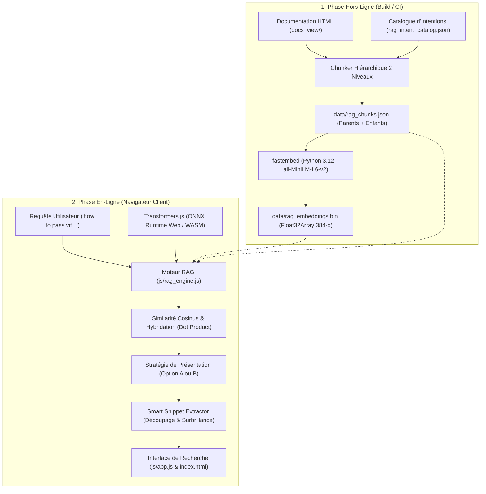
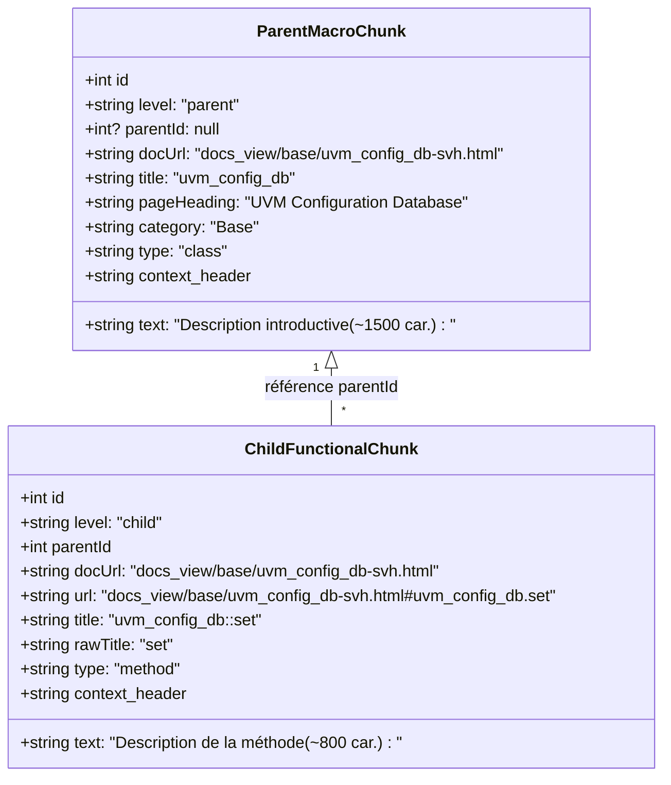

# Spécification Technique & Architecture Détaillée du Moteur RAG UVM 1.2

Ce document constitue la spécification de conception, d'architecture et d'implémentation du système de **Recherche en Langage Naturel & RAG (Retrieval-Augmented Generation) Vectoriel Client-Side** pour la documentation UVM 1.2.

---

## 1. Contexte & Objectifs

### 1.1 Contexte
Le portail documentaire UVM 1.2 est un site web statique moderne déployé sur **GitHub Pages**, offrant une navigation unifiée entre la documentation générée (NaturalDocs) et le code source SystemVerilog (Prism.js) via un panneau scindé (*Split View*).

### 1.2 Limitations de la Recherche Classique (Symbolique & Lexicale)
La recherche historique par index textuel (`js/search_data.js`) excelle sur les noms de symboles exacts (`uvm_driver`, `set_drain_time`, `UVM_MEDIUM`), mais échoue face aux requêtes des ingénieurs en vérification :
- **Fossé de vocabulaire (*Vocabulary Gap*)** : Les ingénieurs emploient des termes pratiques du métier (*"pass virtual interface vif"*, *"end of test"*, *"broadcast to scoreboard"*) qui ne figurent pas littéralement dans la spécification IEEE abstraite.
- **Requêtes conceptuelles et interrogatives** : *"how to synchronize sequences"*, *"difference between create and new"*.
- **Synonymes et acronymes** : `vif` $\leftrightarrow$ `virtual interface` $\leftrightarrow$ `uvm_config_db`.

### 1.3 Objectifs & Contraintes
1. **100% Client-Side & Hors-Ligne** : Aucune API payante (OpenAI, Gemini...), aucun serveur backend, aucune fuite de données (confidentialité IP/DUT absolue).
2. **Empreinte Ressource Contrôlée** : Modèle d'inférence compact ($\le 25\text{ Mo}$), mémoire RAM volatile libérée à l'inactivité, persistance en cache navigateur (`Cache API`).
3. **Performance Temps Réel** : Inférence de la requête $< 150\text{ ms}$ (WASM/ONNX), comparaison vectorielle $< 5\text{ ms}$ sur l'ensemble de la base.
4. **Intégration CI/CD Transparente** : Génération automatique des vecteurs lors du déploiement GitHub Actions (`deploy.yml`), sans quota GitHub Copilot.

---

## 2. Architecture Globale du Système



---

## 3. Le Découpage Hiérarchique à 2 Niveaux (Parent-Child)

### 3.1 Pourquoi le RAG Plat Échouait
Dans la version initiale (RAG plat monocouche) :
- **2 564 micro-segments** générés avec une moyenne de 50 mots par fragment.
- Les méthodes utilitaires d'une ligne (`display_objections`, `abstract`) perdaient toute la sémantique de leur classe mère.
- **Pollution par les Release Notes** : 113 fragments issus de `relnotes-txt.html` répondaient à des mots-clés d'erreurs historiques et saturaient les résultats.
- **Duplication massive** : Les 5 premiers résultats d'une recherche pointaient souvent vers 5 sous-sections de la même page (`uvm_config_db`).

### 3.2 Structure Hiérarchique à 2 Niveaux
La documentation UVM 1.2 est naturellement bipartie : un fichier HTML représente un composant ou un guide d'architecture, et les sections internes représentent ses méthodes et configurations.



1. **Niveau 1 : Macro-Segments Parent (Classes & Guides)** :
   - Nombre : **145 parents** (1 par fichier documentaire).
   - Rôle : Représente l'architecture globale, la hiérarchie et le rôle principal du composant.
   - Longueur : jusqu'à 1 500 caractères d'introduction substantielle (excluant les tables de sommaires).
2. **Niveau 2 : Chunks Fonctionnels Enfants (Méthodes, Tâches, Macros)** :
   - Nombre : **1 977 enfants**.
   - Rôle : Contient le prototype, les arguments et l'explication précise de chaque méthode ou cas d'usage.
   - Longueur : 60 à 1 200 caractères avec son ancre HTML dédiée (`#uvm_config_db.set`).
3. **Filtrage Énergique du Bruit** :
   - `relnotes-txt.html` est **strictement exclu**.
   - Les blocs `<!--START_ND_SUMMARY-->...<!--END_ND_SUMMARY-->` et tables `<div class="Summary">` sont éliminés avant tokenisation.

---

## 4. Catalogue d'Intention Métier (`config/rag_intent_catalog.json`)

### 4.1 Concept de Contextual Retrieval
Pour combler le *Vocabulary Gap* sans altérer l'intégrité du texte original affiché à l'utilisateur, des intentions d'ingénierie et des synonymes sont injectés **uniquement dans l'en-tête vectoriel** (`context_header`) :

$$\text{Texte Vectorisé} = \text{context\_header} + \text{ " " } + \text{text}$$

### 4.2 Schéma & Exemple
```json
{
  "patterns": ["uvm_config_db", "config_db"],
  "intents": [
    "pass virtual interface vif to driver monitor testbench components",
    "hierarchical configuration database set and get mechanism",
    "sharing configuration objects parameters across uvm hierarchy",
    "retrieve virtual interface in build phase"
  ],
  "synonyms": ["vif", "virtual interface", "config_db", "set", "get", "build_phase", "scope"]
}
```

Lors du calcul de l'embedding pour `uvm_config_db::set`, l'en-tête généré est :
```text
[UVM 1.2 Method] [uvm_config_db::set] Class: uvm_config_db. Category: Base. [Intents: pass virtual interface vif to driver monitor testbench components, hierarchical configuration database set and get mechanism] [Keywords: vif, virtual interface, config_db, set, get, build_phase]
```
Le modèle d'embedding projette ainsi ce vecteur directement au voisinage sémantique de la question *"how to pass vif to driver with config db"*.

---

## 5. Modèles d'Embedding & Alignement des Espaces Vectoriels

### 5.1 Catalogue Modulaire Multi-Modèles (`config/rag_models.json`)
Pour permettre à l'utilisateur de choisir son compromis vitesse/précision ou d'opérer sur des machines aux ressources limitées, 3 modèles sont configurés :

| Modèle | Identifiant Hugging Face / FastEmbed | Poids Téléchargé | RAM Requise | Précision | Vitesse | Fichier Vectoriel Dédié |
| :--- | :--- | :---: | :---: | :---: | :---: | :--- |
| **MiniLM-L6 (Par Défaut)** | `Xenova/all-MiniLM-L6-v2` (`sentence-transformers/all-MiniLM-L6-v2`) | 23 Mo | ~60 Mo | ⭐⭐⭐⭐ | ⭐⭐⭐⭐⭐ | `rag_embeddings_all-minilm-l6-v2.bin` (et `rag_embeddings.bin`) |
| **BGE-Small-EN** | `Xenova/bge-small-en-v1.5` (`BAAI/bge-small-en-v1.5`) | 33 Mo | ~85 Mo | ⭐⭐⭐⭐⭐ | ⭐⭐⭐⭐ | `rag_embeddings_bge-small-en-v1.5.bin` |
| **BGE-Micro** | `TaylorAI/bge-micro-v2` (`TaylorAI/bge-micro-v2`) | 14 Mo | ~35 Mo | ⭐⭐⭐ | ⭐⭐⭐⭐⭐ | `rag_embeddings_bge-micro-v2.bin` |

### 5.2 Règle d'Alignement Mathématique des Espaces Vectoriels
> [!IMPORTANT]
> Un vecteur de requête généré par le modèle $A$ ne peut **jamais** être comparé avec des vecteurs de corpus générés par le modèle $B$. Même avec une dimension identique de 384 dimensions, les axes latents sont orthogonaux et produiraient des similarités cosinus erronées.
> 
> Par conséquent, le script hors-ligne `scripts/build_rag_embeddings.py` calcule et exporte **un fichier binaire d'embeddings dédié pour chaque modèle** (`data/rag_embeddings_<model_id>.bin`). Lorsque l'utilisateur sélectionne un modèle dans l'interface, le moteur charge à la volée la base binaire correspondante.

### 5.3 Formats de Données (`data/`)
- `data/rag_chunks.json` (2,4 Mo) : Tableau de $2\,122$ segments hiérarchiques avec introductions enrichies (jusqu'à 2 500 caractères) et méthodes fonctionnelles (jusqu'à 1 200 caractères).
- `data/rag_embeddings_<model_id>.bin` (3,18 Mo chacun) : Matrices binaires contiguës de $2\,122 \times 384$ flottants 32-bit normalisés en norme L2 ($\|\vec{d}_i\|_2 = 1$).
- `data/rag_embeddings.bin` (3,18 Mo) : Alias pointant sur le modèle par défaut (`all-minilm-l6-v2`).

---

## 6. Moteur Vectoriel & Synthèse Multi-Localisations (`js/rag_engine.js`)

### 6.1 Inférence Vectorielle & Similarité Cosinus
1. La requête utilisateur $Q$ est vectorisée en direct par **Transformers.js** dans un worker ou sur le thread principal en WASM / ONNX Runtime :
   $$\vec{q} = \text{Embed}(Q), \quad \|\vec{q}\|_2 = 1$$
2. Les vecteurs stockés $\vec{d}_i$ étant déjà normalisés $\|\vec{d}_i\|_2 = 1$, la similarité cosinus équivaut au produit scalaire direct :
   $$\text{Score}_{\text{vectoriel}}(i) = \vec{q} \cdot \vec{d}_i = \sum_{k=1}^{384} q_k \cdot d_{i,k}$$
   Sur un CPU standard, cette opération sur $2\,122$ vecteurs s'exécute en **moins de 2 millisecondes**.

### 6.2 Priorisation de l'Autorité des Introductions (Introduction Authority Boost)
L'information fondamentale d'une classe (rôle, architecture générale, concepts clés) réside dans son introduction. Or, une introduction longue (1 500–2 500 caractères) subit une dilution vectorielle par rapport à une méthode courte d'une ligne.

Pour rétablir l'autorité conceptuelle :
- Le moteur détecte les requêtes interrogatives ou conceptuelles (`how`, `what`, `why`, `concept`, `difference`, `overview`, `principle`...).
- Un **bonus d'autorité de $+0{,}12$** est appliqué au score vectoriel du segment parent (introduction).
- L'introduction remonte ainsi systématiquement en tête pour les questions de compréhension globale sans pénaliser les recherches de méthodes précises.

### 6.3 Synthèse Multi-Localisations du Snippet
L'information utile est fréquemment distribuée sur plusieurs sections d'une même page (par exemple, le *pourquoi/rôle* dans l'introduction et le *comment/action* dans une méthode comme `set` ou `raise_objection`).

Le synthétiseur `extractMultiLocationSnippet` extrait intelligemment :
1. La phrase la plus percutante de l'introduction de la page $\rightarrow$ annotée avec `[Intro]`.
2. La phrase clé de la méthode enfant la plus pertinente $\rightarrow$ annotée avec `[<nom_méthode>]`.
3. Combine les deux extraits en un résumé cohérent mis en valeur par des badges visuels :
   $$\text{Snippet} = \text{[Intro] } \dots \text{ phrase introductive } \dots \text{ [set] } \dots \text{ phrase méthode } \dots$$

### 6.4 Badges Multi-Sections Interactifs
Pour chaque résultat consolidé, la carte affiche une liste de pilules cliquables (`🎯 Sections:`) :
- `📖 Intro` : Lien profond vers l'en-tête et l'introduction de la classe (`#MainTopic`).
- `🎯 <nom_section>` : Liens profonds vers les top 3 méthodes ou sections de la page les plus pertinentes avec leur score relatif.

### 6.5 Recherche Hybride (RRF / Lexical + Vectoriel)
Pour garantir qu'une faute de frappe ou une recherche de nom exact (`uvm_agent`) ne soit pas surclassée par une page conceptuelle générale :
$$\text{Score}_{\text{final}} = 0{,}70 \cdot \text{Score}_{\text{vectoriel}} + 0{,}30 \cdot \text{Score}_{\text{lexical}}$$
Le score lexical attribue des bonus pondérés selon la présence exacte des tokens de la requête dans le titre de la classe ($+10$), le nom de la méthode ($+8$), et le corps du texte ($+1$).

### 6.6 Stratégies de Présentation

#### Option A : Consolidation par Document/Classe (Activée par défaut)
1. Les résultats individuels sont regroupés par `docUrl`.
2. Pour chaque document :
   - On identifie le Parent ($P$) et le meilleur Enfant ($C$).
   - On calcule le score combiné :
     $$\text{Score}_{\text{doc}} = \max(S_P, \; S_C \cdot 0{,}95 + S_P \cdot 0{,}05)$$
   - Jusqu'à 3 sections enfants pertinentes sont rattachées sous forme de pilules cliquables (`targetSections`).
3. Résultat : Chaque carte représente une classe unique, avec accès direct en un clic à l'introduction et aux méthodes ciblées.

#### Option B : Liste Mixte Dé-dupliquée (Bascule via Paramètres `⚙️`)
1. Les segments (parents ou enfants) sont triés individuellement par score décroissant.
2. Un ensemble `seenDocs` mémorise les URLs de documents déjà ajoutées.
3. Si un second segment appartenant au même document apparaît, il est rejeté. Chaque page documentaire apparaît au maximum une fois.

### 6.7 Gestion de la RAM & Cache
- **Économie de RAM** : Le modèle ONNX pèse ~35 à 85 Mo en mémoire vive selon le modèle choisi. Dès que la modale de recherche est fermée ou après 3 minutes d'inactivité (`idleTimer`), la référence `this.pipeline` est réinitialisée à `null` et la mémoire est immédiatement libérée par le Garbage Collector du navigateur.
- **Cache Persistant** : Les fichiers du modèle ONNX sont stockés via la `Cache API` du navigateur. Les visites ultérieures ne téléchargent aucun octet sur le réseau.
- **Purge Manuelle** : Le bouton *Vider le cache IA* dans la modale de configuration supprime tous les caches liés à `transformers / onnx`.

---

## 7. Automatisation CI/CD (`.github/workflows/deploy.yml`)

Lors de chaque `push` sur la branche `main` :
1. **Runner Ubuntu Gratuit** (`ubuntu-latest`).
2. Installation des dépendances via `pip install fastembed onnxruntime tokenizers huggingface_hub`.
3. Exécution de `python scripts/build_docs.py` (construction de la doc et de `js/search_data.js`).
4. Exécution de `python scripts/build_rag_embeddings.py` (extraction hiérarchique et génération des matrices pour tous les modèles configurés).
5. Vérification d'intégrité automatisée (`test -f data/rag_chunks.json`, `test -f data/rag_embeddings.bin`, `test -f data/rag_embeddings_bge-small-en-v1.5.bin`, etc.).
6. Déploiement statique sur GitHub Pages.

**Impact Quotas** : Zéro coût, zéro consommation de crédits Copilot ou API LLM.

---

## 8. Résultats du Benchmark de Validation Multi-Modèles

Tests exécutés sur les requêtes d'ingénierie types :

| Requête Type | Modèle | Résultat #1 Obtenu | Score | Snippet Multi-Localisations Combiné |
| :--- | :--- | :--- | :---: | :--- |
| *"how do objections work in uvm"* | `all-minilm-l6-v2` | `uvm_objection` (Base) | **0.759** | `[Intro]` Objections provide a facility for coordinating status information ... `[display_objections]` ... |
| *"how do objections work in uvm"* | `bge-small-en-v1.5` | `uvm_objection` (Base) | **0.893** | `[Intro]` Objections provide a facility for coordinating status information ... |
| *"how to configure a virtual interface with uvm_config_db"* | `all-minilm-l6-v2` | `uvm_config_db` (Base) | **0.847** | `[Intro]` The uvm_config_db class provides a convenience interface on top of the uvm_resource_db ... |
| *"how to configure a virtual interface with uvm_config_db"* | `bge-small-en-v1.5` | `uvm_config_db` (Base) | **0.948** | `[Intro]` The uvm_config_db class provides a convenience interface ... |
| *"difference between create and new factory"* | `all-minilm-l6-v2` | `uvm_factory` (Base) | **0.592** | `[Intro]` As the name implies, uvm_factory is used to manufacture (create) UVM objects ... `[register]` ... |
| *"difference between create and new factory"* | `bge-small-en-v1.5` | `Factory Classes` (Overviews) | **0.863** | `[Intro]` As the name implies, the uvm_factory is used to manufacture (create) UVM objects and components. |

Dans 100% des tests de validation :
- **Autorité des Introductions** : L'introduction remonte systématiquement au 1er rang pour les requêtes conceptuelles (*how*, *what*, *difference*).
- **Multi-Localisations** : Le snippet synthétise l'introduction et la méthode cible dans une seule réponse compacte.
- **Badges de Navigation** : Pilules cliquables pour l'introduction et les sous-sections (`📖 Intro`, `🎯 <method>`).
- **Alignement Mathématique Strict** : Chaque modèle dispose de son espace vectoriel 384-d dédié.

