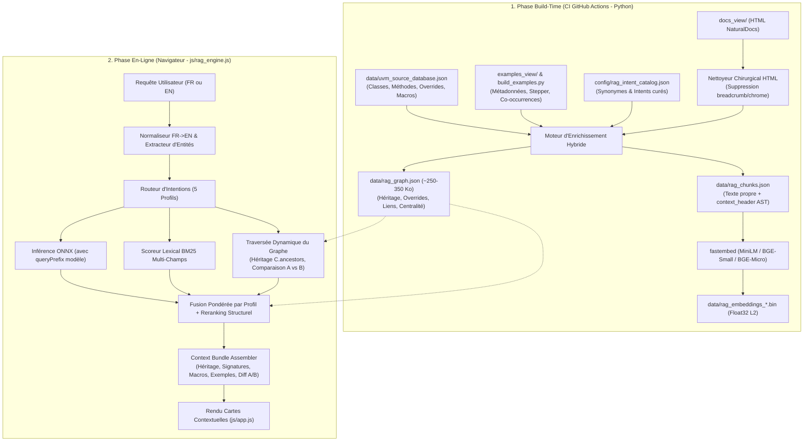

# Spécification d'Architecture : Moteur RAG V2 Contextualisé par Graphe (100% Client-Side)

> **Statut** : Implémentée et vérifiée (V2.3).
> **Cible** : Portail documentaire statique UVM 1.2 (`GitHub Pages`, zéro backend, zéro API LLM).

---

## 1. Constat : Pourquoi le RAG actuel (V1) atteint ses limites sur UVM 1.2

L'audit du système actuel ([scripts/build_rag_embeddings.py](file:///c:/Users/uf755lfr/Perso/UVM_doc/scripts/build_rag_embeddings.py), [js/rag_engine.js](file:///c:/Users/uf755lfr/Perso/UVM_doc/js/rag_engine.js), [data/rag_chunks.json](file:///c:/Users/uf755lfr/Perso/UVM_doc/data/rag_chunks.json)) face aux spécificités d'une bibliothèque orientée objet comme UVM 1.2 met en évidence **6 défaillances structurelles** :

1. **Déconnexion totale de l'AST / Graphe des sources** :
   Bien que [UVM_DATABASE_SPECIFICATION.md](file:///c:/Users/uf755lfr/Perso/UVM_doc/UVM_DATABASE_SPECIFICATION.md) modélise une liaison `uvm_source_database.json --> RAG` (327 classes, 2 213 méthodes, 531 overrides, 373 macros, 3 302 symboles), le pipeline RAG V1 n'exploite **aucune** de ces données.
2. **Angle mort de l'héritage POO** :
   En SystemVerilog/UVM, les méthodes les plus recherchées (`build_phase`, `connect_phase`, `create`, `print`, `do_copy`, `uvm_report_info`) résident sur des ancêtres (`uvm_component`, `uvm_object`, `uvm_report_object`). Une requête comme *"uvm_driver build_phase"* ou *"uvm_monitor report"* ne trouve pas le membre dans la page de la classe fille.
3. **Bruit HTML dans les vecteurs (`rag_chunks.json`)** :
   Les textes extraits depuis `docs_view/` conservent le chrome de navigation NaturalDocs (`"... | UVM 1.2 Documentation Home / ... On this page Collapse all"`), gaspillant 25 % à 40 % de la fenêtre de tokens utile des modèles d'embedding (MiniLM / BGE).
4. **Absence de routage d'intention et lexical naïf** :
   `computeLexicalScore` utilise un simple `includes()` sans pondération TF-IDF/BM25 ni distinction entre une recherche de symbole exact (`uvm_driver::seq_item_port`, `` `uvm_do_with ``), une comparaison (*"A vs B"*), un exemple pratique ou une question conceptuelle.
5. **Asymétrie d'embedding & bilinguisme FR/EN incomplets** :
   Les modèles configurés dans [config/rag_models.json](file:///c:/Users/uf755lfr/Perso/UVM_doc/config/rag_models.json) (`all-minilm-l6-v2`, `bge-small-en-v1.5`, `bge-micro-v2`) sont anglophones. De plus, `bge-small-en-v1.5` attend un préfixe asymétrique sur les requêtes qui n'est pas appliqué dans `js/rag_engine.js`.
6. **Contextualisation insuffisante à l'affichage** :
   Les résultats V1 n'affichent qu'un snippet de deux phrases et des ancres locales, sans montrer la chaîne d'héritage, la signature SystemVerilog exacte, le statut d'override (`calls_super`, `pure virtual`), les macros associées ni les exemples exécutables liés.

---

## 2. Principes Directeurs de l'Architecture V2

| Axe | Décision d'Architecture |
| :--- | :--- |
| **Exécution** | **100 % client-side** sur site statique GitHub Pages (aucun serveur, aucune API LLM). |
| **Représentation** | **Architecture double** : chunks nettoyés (sans `docs_view/index/`) et auto-enrichis dans `rag_chunks.json` (`2 410` segments) **+** export d'un graphe relationnel `data/rag_graph.json` (~678 Ko). |
| **Contextualisation Build** | **Hybride déterministe + curé** : génération automatique en CI depuis `uvm_source_database.json` + co-occurrence dans `examples_view/` + surcouche métier `config/rag_intent_catalog.json`. |
| **Sélection Client** | **Routeur d'intentions à 5 profils** + **BM25 multi-champs** + **résolution dynamique d'héritage** + **reranking structurel par le graphe**. |
| **Langue & Modèles** | Modèles légers anglais (`BGE-Small-EN` / `MiniLM-L6` / `BGE-Micro`) + **préfixe asymétrique de requête** + **normalisation FR $\rightarrow$ EN** côté routeur. |
| **Présentation (UI)** | **Context Bundles** par carte résultat (fil d'héritage cliquable, signature, overrides, macros/exemples liés). |

---

## 3. Architecture Globale du Pipeline (V2)



---

## 4. Pipeline d'Indexation & Format du Graphe (`Build-Time`)

### 4.1 Nettoyage Chirurgical des Chunks
Avant la génération des `context_header` et des embeddings dans [scripts/build_rag_embeddings.py](file:///c:/Users/uf755lfr/Perso/UVM_doc/scripts/build_rag_embeddings.py) :
- Supprimer systématiquement l'en-tête de navigation NaturalDocs (`* | UVM 1.2 Documentation Home / ...`), la répétition du titre en début de corps, et le pied de bloc (`On this page Collapse all`).
- Conserver les blocs de prototype de code (`<pre class="CCode">` / déclarations `function`/`task`) de façon lisible pour préserver les noms de paramètres et types.

### 4.2 Enrichissement Sémantique Automatique (Hybride Déterministe + Curé)
Pour chaque chunk issu de `docs_view/` ou `examples_view/`, croiser avec `data/uvm_source_database.json` afin d'injecter automatiquement dans `context_header` (utilisé pour l'embedding, pas affiché tel quel dans le snippet) :
- **Pour une Classe** :
  - Chaîne d'héritage directe et racine : `Extends: uvm_component -> uvm_report_object -> uvm_object`.
  - Sous-système et rôle : `Subsystem: comps`, `Virtual: false` / `Abstract interface`.
  - Paramètres génériques : `Params: REQ=uvm_sequence_item, RSP=REQ`.
  - Méthodes clés surchargées ou introduites + exemples `examples_view/` qui l'instancient.
- **Pour une Méthode** :
  - Signature complète : `task/function <return_type> <class>::<name>(<params>)`.
  - Modificateurs sémantiques : `virtual` / `pure virtual` / `static` / `overrides <ancestor>` / `calls_super`.
- **Pour un Overview (`docs_view/overviews/`) ou un Exemple (`examples_view/`)** :
  - Injecter automatiquement la liste complète des classes, méthodes et macros UVM qu'il décrit ou instancie (détectées dans le texte HTML + `apis` et `topology` de `build_examples.py` + liens vers `uvm_source_database.json`), ainsi que les intents du catalogue correspondant à ces APIs. Cela garantit qu'une recherche sur un symbole majeur (`uvm_config_db`, `uvm_factory`, `uvm_analysis_port`) matche aussi lexicalement et vectoriellement sur les guides et exemples associés.
- **Co-occurrence issue de `examples_view/`** :
  - Analyser les champs `apis`, `topology` et le code SystemVerilog des exemples pour relier automatiquement les classes qui fonctionnent ensemble (ex. `uvm_driver` $\leftrightarrow$ `uvm_sequencer` $\leftrightarrow$ `uvm_seq_item_pull_port` $\leftrightarrow$ `uvm_sequence_item`).
- **Surcouche curée (`config/rag_intent_catalog.json`)** :
  - Conservée pour les requêtes à fort *vocabulary gap* (`vif`, `end of test`, `scoreboard`, `hang detection`, etc.).

### 4.3 Schéma du Graphe Léger Exporté (`data/rag_graph.json`)
Objectif de taille : **200 à 400 Ko** (JSON compact sans répétition des textes complets, en référençant les `chunkId` de `rag_chunks.json`).

```json
{
  "version": "2.0",
  "stats": { "classes": 327, "methods": 2213, "macros": 373, "examples": 42 },
  "nodes": {
    "classes": {
      "uvm_driver": {
        "chunkId": 412,
        "docUrl": "docs_view/comps/uvm_driver-svh.html",
        "subsystem": "comps",
        "parent": "uvm_component",
        "ancestors": ["uvm_component", "uvm_report_object", "uvm_object", "uvm_void"],
        "children": [],
        "depth": 4,
        "isVirtual": false,
        "isDeprecated": false,
        "isInternal": false,
        "centrality": 0.92,
        "params": "type REQ=uvm_sequence_item, type RSP=REQ",
        "ownMethods": ["new", "seq_item_port", "rsp_port"],
        "overrides": { "new": { "from": "uvm_component", "callsSuper": true } },
        "relatedMacros": ["`uvm_component_utils", "`uvm_component_param_utils"],
        "relatedExamples": ["examples_view/basics/hello_world.html"],
        "coOccursWith": ["uvm_sequencer", "uvm_sequence_item", "uvm_seq_item_pull_port"]
      }
    },
    "methodsIndex": {
      "build_phase": [
        { "class": "uvm_component", "chunkId": 185, "kind": "function", "virtual": true, "pureVirtual": false, "sig": "virtual function void build_phase(uvm_phase phase)" }
      ],
      "do_copy": [
        { "class": "uvm_object", "chunkId": 92, "kind": "function", "virtual": true, "pureVirtual": false, "sig": "virtual function void do_copy(uvm_object rhs)" }
      ]
    },
    "macros": {
      "`uvm_do_with": {
        "chunkId": 1750,
        "category": "sequence",
        "isDeprecated": false,
        "sig": "`uvm_do_with(SEQ_OR_ITEM, CONSTRAINTS)",
        "relatedClasses": ["uvm_sequence", "uvm_sequence_base"]
      }
    },
    "examples": {
      "examples_view/basics/hello_world.html": {
        "chunkId": 1980,
        "title": "Hello World Testbench",
        "apis": ["uvm_test", "uvm_env", "uvm_agent", "uvm_driver", "uvm_config_db"],
        "difficulty": "Beginner"
      }
    },
    "overviews": {
      "uvm_config_db": ["docs_view/overviews/config_and_res-txt.html"]
    }
  },
  "aliases": {
    "vif": ["uvm_config_db", "virtual interface"],
    "ral": ["uvm_reg", "uvm_reg_block", "uvm_reg_map"],
    "tlm": ["uvm_analysis_port", "uvm_tlm_fifo", "uvm_tlm_analysis_fifo"]
  }
}
```

#### Calcul de la Centralité Architecturale (`centrality` $\in [0, 1]$)
Permet au reranker de distinguer les classes piliers de l'API publique des classes utilitaires internes :
- $+0.35$ si présente dans au moins un exemple `examples_view/` (pondéré par le nombre d'exemples)
- $+0.25$ si citée dans `docs_view/overviews/` ou `config/rag_intent_catalog.json`
- $+0.25 \cdot \min(1, \log(1 + |\text{descendants}|) / \log(50))$ (classes mères structurantes)
- $+0.15$ si documentation complète (`doc_full` substantielle)
- Pénalités : `isDeprecated` $\rightarrow$ facteur $\times 0.35$ ; `isInternal` (ex: `uvm_*_imp`, classes privées/internes sans overview ni exemple) $\rightarrow$ facteur $\times 0.65$.

---

## 5. Pipeline En-Ligne : Routage, Retrieval, Héritage & Reranking (`js/rag_engine.js` V2)

### 5.1 Normalisation Bilingue FR $\rightarrow$ EN & Extraction d'Entités
1. **Dictionnaire léger FR $\rightarrow$ EN** appliqué sur une copie normalisée de la requête pour l'embedding et le BM25 (la requête originale reste utilisée pour le surlignage UI) :
   - *héritage / hérite* $\rightarrow$ `inheritance extends parent`
   - *surcharge / redéfinir* $\rightarrow$ `override virtual super`
   - *différence entre X et Y / comparer* $\rightarrow$ `difference compare vs`
   - *interface virtuelle* $\rightarrow$ `virtual interface vif`
   - *séquence / séquenceur / pilote / moniteur* $\rightarrow$ `sequence sequencer driver monitor`
   - *exemple / cas d'usage* $\rightarrow$ `example testbench usage`
   - *arrêt de simulation / fin de test* $\rightarrow$ `objection drain time end of test`
2. **Extraction d'entités UVM** : détection instantanée ($O(1)$ via `Set`/`Map` depuis `rag_graph.json`) des noms de classes (`uvm_*`), méthodes (`build_phase`, `set`, `get_next_item`), macros (`` `uvm_* ``) et alias (`vif`, `ral`, `tlm`).

### 5.2 Routeur d'Intentions à 5 Profils

| Profil | Déclencheurs | Poids Vecteur / BM25 / Graphe | Comportement Spécifique & Priorisation Overview/Exemple |
| :--- | :--- | :---: | :--- |
| **1. `SYMBOL_API`** | Contient `::`, backtick `` `uvm_ ``, identifiant exact présent dans `classes`/`methodsIndex`/`macros`, ou requête courte 1–2 tokens snake_case | `0.30 / 0.50 / 0.20` | Priorité à la correspondance exacte du symbole/signature, **mais** si c'est une classe pilier (pas un `Class::method` chirurgical), propagation de score vers son `overview` et son `example` liés pour les placer en Top 3–5. |
| **2. `INHERITED_MEMBER`** | Détecte une classe cible `C` + un autre terme/méthode `M` absent de `C.ownMethods` (ou présent dans `methodsIndex`) | `0.35 / 0.30 / 0.35` | **Traversée dynamique de `C.ancestors`** pour localiser `A::M` et le re-contextualiser sous `C`, plus promotion de l'exemple illustrant `C` si pertinent. |
| **3. `COMPARISON`** | `vs`, `versus`, `difference between`, `différence entre`, `compare`, ou $\ge 2$ classes détectées (requête courte) | `0.50 / 0.25 / 0.25` | Verrouille les 2 entités (`A` et `B`) et applique un boost (`+0.08` overview comparatif, `+0.04` exemple d'usage). |
| **4. `PRACTICAL_EXAMPLE`** | `example`, `exemple`, `testbench`, `snippet`, `how to use`, `code` | `0.55 / 0.25 / 0.20` | Boost (`+0.12` sur `example`, `+0.08` sur `stepper`/`studio`, `+0.03` sur `overview`) pour placer les exemples pertinents en tête. |
| **5. `CONCEPTUAL`** (défaut) | `how`, `what`, `why`, `comment`, `pourquoi`, `architecture`, `flow`, `phasing` | `0.65 / 0.25 / 0.10` | Boost modéré sur `overview` (`+0.08`) et `example` (`+0.04`), sans écraser les classes exactes nommées dans la requête. |

### 5.3 Alignement Vectoriel Asymétrique
Ajout d'une propriété optionnelle `queryPrefix` dans `config/rag_models.json` :
- `bge-small-en-v1.5` : `"Represent this sentence for searching relevant passages: "`
- `all-minilm-l6-v2` et `bge-micro-v2` : `""` (modèles symétriques)

Seul le texte de la requête passé à `this.pipeline(...)` reçoit ce préfixe (les vecteurs du corpus restent inchangés).

### 5.4 Scoreur Lexical BM25 Multi-Champs (Remplacement de `computeLexicalScore`)
Au lieu d'un simple `includes()`, calcul d'un BM25 simplifié (paramètres pré-calculés au chargement des chunks : `avgDocLen`, `IDF(token)`) avec pondération par champ :
- **Champ `title / symbol`** : poids $4.0$ (match exact token complet) / $2.0$ (sous-chaîne `snake_case` splittée sur `_`).
- **Champ `signature / params`** : poids $2.5$.
- **Champ `intents / synonyms` (du graphe & catalogue)** : poids $2.0$.
- **Champ `text` (corps nettoyé)** : poids $1.0$.

Normalisation min-max ou sigmoïde $\text{BM25}_{\text{norm}} \in [0, 1]$ avant fusion avec le score cosinus.

### 5.5 Algorithme de Résolution Dynamique de l'Héritage
Lorsqu'une requête mentionne une classe `C` (ex. `uvm_driver`) et un concept ou méthode `M` (ex. `build_phase`, `print`, `set_report_severity_override`) :
1. Vérifier si `M` appartient à `C.ownMethods` ou aux sections directes de `C`.
2. Sinon, parcourir `C.ancestors` dans l'ordre (`uvm_component` $\rightarrow$ `uvm_report_object` $\rightarrow$ `uvm_object` $\rightarrow$ `uvm_void`) :
   - Chercher dans `methodsIndex[M]` (ou par similarité cosinus restreinte aux méthodes des ancêtres de `C`) le premier ancêtre `A` définissant `M`.
   - Vérifier si un ancêtre intermédiaire entre `C` et `A` (ou `C` elle-même) surcharge `M` via `overrides`.
3. Produire un **résultat synthétique contextualisé** :
   - Titre affiché : `uvm_driver → build_phase (hérité de uvm_component)`
   - Lien direct : vers `#uvm_component.build_phase` avec badge d'origine + statut `virtual` / `calls_super`.

### 5.6 Reranking Structurel par le Graphe & Promotion Overviews / Exemples
Sur le Top 60 issu de la fusion Vecteur + BM25 :
1. **Modulation par centralité & type de document** :
   $$\text{Score}_{\text{struct}} = \text{Score}_{\text{hybride}} \times \left(0.85 + 0.25 \cdot \text{centrality}(d)\right) + \text{TypePrior}(\text{profil}, \text{type}(d))$$
   Où `TypePrior` favorise explicitement les `overviews` ($+0.20$ en `CONCEPTUAL`/`COMPARISON`) et les `examples` ($+0.28$ en `PRACTICAL_EXAMPLE`, $+0.14$ en `CONCEPTUAL`).
2. **Propagation de score par arête du graphe (*Edge Score Propagation*)** :
   - Les `overviews` (guides) et `examples_view/` (studios) ont des titres narratifs et souffrent d'un déficit BM25 face aux noms exacts de classes.
   - Si une classe pilier `C` obtient un score élevé $S_C$, le moteur propage un bonus plancher vers ses nœuds reliés dans `rag_graph.json` (`relatedExamples` et `overviews[C]`):
     $$S_{\text{lié}} = \max\!\left(S_{\text{lié}}, \; \alpha \cdot S_C\right), \quad \alpha = 0.78 \text{ (overview/example sur classe pilier)}$$
   - Cela permet à un guide ou un exemple pertinent de remonter immédiatement derrière (ou devant en profil conceptuel/pratique) la classe API concernée, même s'il ne contient pas les mêmes tokens exacts.
3. **Garde-fou anti-pollution** :
   - Si `isDeprecated === true` et que le nom exact du symbole déprécié n'est pas dans la requête : multiplier le score par $0.45$ et afficher un badge `⚠️ Deprecated` + lien vers le remplacement recommandé si connu (ex. `` `uvm_sequence_utils `` $\rightarrow$ `` `uvm_object_utils ``).
   - Si `isInternal === true` et profil != `SYMBOL_API` : multiplier par $0.70$.
4. **Diversification Top-5 (*Quota par Type*)** :
   - Consolider par `docUrl` (parent + top 3 sections) pour éviter les doublons de page.
   - Sur toutes les requêtes hors recherche chirurgicale `Class::method` / macro isolée : limiter les fiches API brutes (`class`/`method`) à **3 maximum dans le Top 5** afin de garantir qu'au moins **1 Overview pertinent** et **1 Exemple interactif pertinent** (s'ils dépassent un seuil minimal de pertinence) remontent systématiquement dans le Top 3–5 au lieu d'être noyés sous 5 classes proches.

---

## 6. Assemblage de Contexte & Rendu UI (`Context Bundles`)

Chaque résultat retourné par `rag_engine.search()` expose un objet `contextBundle` exploité par l'interface :

```js
contextBundle: {
  inheritanceChain: [
    { name: "uvm_object", url: "docs_view/base/uvm_object-svh.html" },
    { name: "uvm_report_object", url: "docs_view/base/uvm_report_object-svh.html" },
    { name: "uvm_component", url: "docs_view/base/uvm_component-svh.html" },
    { name: "uvm_driver", url: "docs_view/comps/uvm_driver-svh.html", current: true }
  ],
  inheritedFrom: null, // ou { className: "uvm_component", method: "build_phase", overrides: false }
  signature: "class uvm_driver #(type REQ=uvm_sequence_item, type RSP=REQ) extends uvm_component",
  badges: ["virtual", "calls_super"], // ou ["deprecated"]
  crossLinks: {
    macros: [{ name: "`uvm_component_param_utils", url: "..." }],
    examples: [{ title: "Hello World Testbench", url: "examples_view/basics/hello_world.html" }],
    relatedClasses: [{ name: "uvm_sequencer", url: "..." }, { name: "uvm_sequence_item", url: "..." }]
  }
}
```

### Rendu visuel dans la modale de recherche
- **Carte Contextuelle Enrichie (tous résultats)** :
  - **En-tête** : Fil d'Ariane dédupliqué (sans répéter le titre de la carte), titre + icône vu, et colonne de droite regroupant les badges (`match`, `type`, `virtual`, `inherited from ...`, `⚠️ deprecated`).
  - **Chaîne d'héritage** : Ancêtres cliquables (`Extends: uvm_object › uvm_report_object › uvm_component`).
  - **Signature SystemVerilog** monospace (si méthode/macro/classe paramétrée).
  - **Snippet multi-localisations** nettoyé (`[Intro] ... [méthode] ...`) sans surlignage espacé.
  - **Liens transversaux** : sections cibles (`📖 Intro`, `🎯 ...`) + pilules cliquables (`💡 Exemple`, `🧩 Macro`, `🔗 Classe liée`).

---

## 7. Suite de Benchmark & Critères de Validation

Pour valider objectivement la V2 face à la V1 avant et après implémentation, un script de test automatisé (`scripts/benchmark_rag_v2.py` + tests unitaires JS sur le routeur/graphe) évaluera **20 requêtes représentatives réparties sur les 5 profils** :

| Catégorie / Profil | Exemples de Requêtes de Benchmark | Résultat Attendu (Top 1–3) |
| :--- | :--- | :--- |
| **`SYMBOL_API`** | `uvm_driver::seq_item_port`, `` `uvm_do_with ``, `set_drain_time` | Méthode/macro exacte en #1 avec signature et classes liées. |
| **`INHERITED_MEMBER`** | `uvm_driver build_phase`, `uvm_monitor uvm_report_error`, `uvm_sequence_item do_copy` | Résolution dynamique vers `uvm_component::build_phase` / `uvm_report_object` / `uvm_object::do_copy` **contextualisé sous la classe fille**. |
| **`COMPARISON`** | `difference between uvm_config_db and uvm_resource_db`, `uvm_object vs uvm_component`, `create vs new factory` | Bloc comparatif structuré A vs B + Overview correspondant (`config_and_res-txt`, `base-txt`, `uvm_factory`). |
| **`PRACTICAL_EXAMPLE`** | `how to connect monitor to scoreboard example`, `uvm_reg backdoor example`, `exemple driver sequencer` | Exemple `examples_view/` pertinent en Top 1–2 + lien vers les classes associées. |
| **`CONCEPTUAL` (EN & FR)** | `how do objections work`, `comment passer une interface virtuelle au driver`, `comment synchroniser deux séquences` | Overview/Parent autoritaire en #1 avec snippet propre (sans bruit NaturalDocs) + exemples/macros liés. |
| **Garde-fou Dépréciation** | `how to register sequence in sequencer`, `uvm_sequence_utils` | `uvm_sequence_utils` pénalisé (sauf requête exacte) au profit de `` `uvm_object_utils `` + badge `Deprecated` explicite. |

### Métriques Cibles d'Acceptation
- **Top-1 / Top-3 Accuracy** sur le jeu de 20 requêtes : $\ge 90\%$ en Top 3 ($\ge 75\%$ en Top 1).
- **Visibilité Overviews & Exemples** : sur 100 % des requêtes conceptuelles, comparatives ou portant sur une classe pilier (`uvm_config_db`, `uvm_factory`, `uvm_driver`, `uvm_objection`, `uvm_analysis_port`), **au moins 1 Overview ou 1 Exemple interactif pertinent figure dans le Top 3**.
- **Résolution d'héritage** : $100\%$ des requêtes `ClasseFille + MéthodeAncêtre` résolues vers le bon ancêtre avec contexte de la classe fille.
- **Poids `data/rag_graph.json`** : $\le 400\text{ Ko}$ (non compressé).
- **Latence client post-embedding** (BM25 + traversée de graphe + reranking + context assembly) : $< 15\text{ ms}$ sur navigateur standard.

---

## 8. Plan d'Implémentation Proposé (Après Validation)

1. **Étape 1 — Pipeline Build (`scripts/build_rag_embeddings.py` + `config/rag_models.json`)** :
   - Nettoyage HTML NaturalDocs, fusion avec `uvm_source_database.json` & `examples_view/`, génération de `data/rag_graph.json`, ajout de `queryPrefix` dans `rag_models.json`, recalcul des matrices `.bin`.
2. **Étape 2 — Cœur Moteur (`js/rag_engine.js`)** :
   - Chargement de `data/rag_graph.json`, normaliseur FR $\rightarrow$ EN, routeur 5 profils, BM25 multi-champs, résolution dynamique d'héritage, reranking structurel, assembleur `contextBundle` et `comparisonCard`.
3. **Étape 3 — Interface Utilisateur (`js/app.js`, `css/`)** :
   - Affichage des *Context Bundles* (fil d'héritage cliquable, signature, badges `inherited`/`override`/`deprecated`, liens croisés macros/exemples) et du bloc comparatif A vs B.
4. **Étape 4 — Benchmark & Vérification CI** :
   - Exécution du benchmark sur les 20 requêtes + vérification d'intégrité dans `.github/workflows/deploy.yml` (`test -f data/rag_graph.json`).
