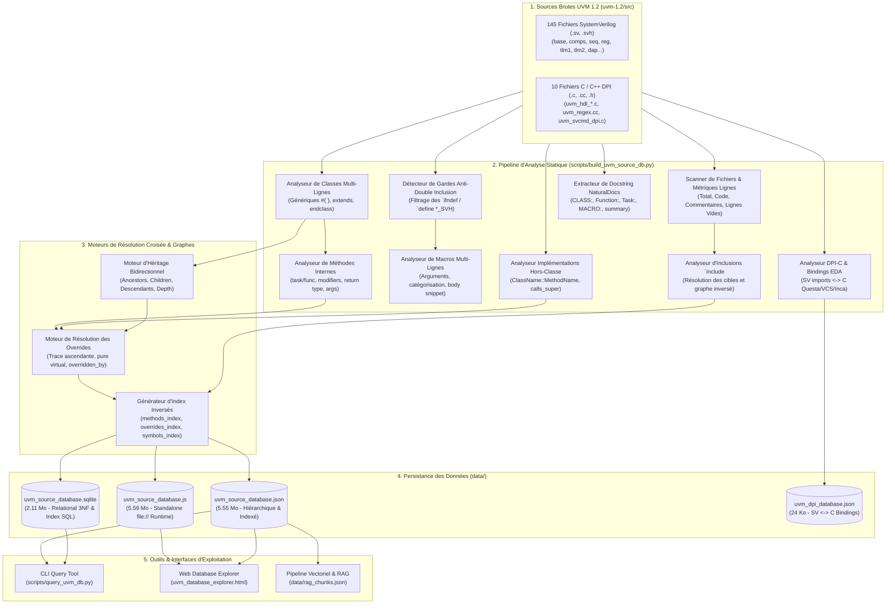
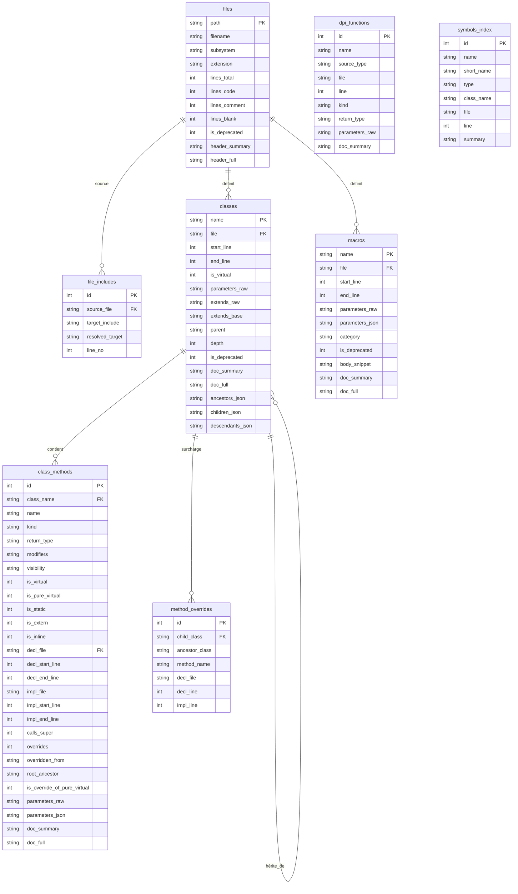

# Spécification Technique & Architecture : Base de Données des Sources UVM 1.2

Ce document constitue la **spécification de conception, d'architecture et de modèle de données** de la base de données exhaustive des sources UVM 1.2, générée à partir des fichiers sources exclusifs situés dans `uvm-1.2/src`.

---

## 1. Contexte & Objectifs

### 1.1 Contexte
Le portail documentaire UVM 1.2 fournit historiquement une documentation HTML statique générée par *Natural Docs* et une vue colorisée du code source (`src_view`). Toutefois, aucune modélisation relationnelle ou hiérarchique exploitable par programme ou par outil n'existait jusqu'alors pour :
- Interroger de manière programmatique la structure des 155 fichiers sources (SystemVerilog et C/DPI).
- Résoudre avec certitude les liens d'héritage ascendants et descendants des 325 classes UVM.
- Tracer avec précision les **méthodes redéfinies (*overrides*)**, en distinguant la classe d'origine ayant introduit le prototype, la déclaration dans la classe dérivée, et l'implémentation hors-classe (*out-of-body* `ClassName::MethodName`).
- Recenser les 373 macros fonctionnelles en éliminant le bruit des gardes anti-double inclusion.
- Cartographier les liaisons entre les imports SystemVerilog `import "DPI-C"` et le code C des différents simulateurs EDA (Questa, VCS, Incisive).

### 1.2 Exigences Fonctionnelles
1. **Source exclusive de vérité** : Extraction déterministe opérée directement sur les fichiers sources bruts de `uvm-1.2/src` (145 fichiers `.sv`/`.svh` et 10 fichiers `.c`/`.cc`/`.h`).
2. **Double persistance structurée** :
   - Format **JSON** (`data/uvm_source_database.json`) : modèle hiérarchique et bidirectionnel avec index inversés de recherche rapide.
   - Format **SQLite** (`data/uvm_source_database.sqlite`) : schéma relationnel 3NF normalisé avec indexations pour requêtes SQL analytiques.
   - Format **JavaScript Bundle** (`data/uvm_source_database.js`) : chargement synchrone (`window.UVM_SOURCE_DATABASE`) pour exécution locale sous protocole `file://` sans contrainte CORS.
3. **Hiérarchie bidirectionnelle stricte** :
   - Fichiers : inclusions sortantes (`includes`) et inclusions entrantes (`included_by`).
   - Classes : ascendance complète (`ancestors`), parent direct (`parent`), enfants directs (`children`), descendance totale (`descendants`), et profondeur (`depth`).
   - Méthodes : méthode enfant $\rightarrow$ méthode ancêtre surchargée (`overridden_from`, `root_ancestor`), et méthode ancêtre $\rightarrow$ liste des classes filles qui la surchargent (`overridden_by`).
4. **Précision positionnelle 1-based** :
   - Ligne de début et ligne de fin pour chaque fichier, inclusion, classe, déclaration de méthode, implémentation de méthode et macro.
5. **Filtrage des gardes d'inclusion** :
   - Exclusion des macros techniques de protection contre la multi-inclusion (`UVM_*_SVH`).
6. **Documentation intégrée (NaturalDocs)** :
   - Extraction des résumés courts (`doc_summary`) et descriptions complètes (`doc_full`) à partir des blocs de commentaires adjacents.

---

## 2. Architecture Globale du Pipeline

---

## 3. Modèle de Données Relationnel (SQLite)

La base SQLite [data/uvm_source_database.sqlite](file:///c:/Dev/UVM_doc/data/uvm_source_database.sqlite) respecte la troisième forme normale (3NF) et comprend 8 tables optimisées par des index B-Tree :

---

## 4. Spécification Détaillée des Entités

### 4.1 Fichiers (`files`)
Chaque fichier dans `uvm-1.2/src` est répertorié avec son appartenance architecturale et ses métriques précises :
- **Sous-systèmes reconnus (`subsystem`)** :
  - `base` : Modèle d'objet de base, phases, fabrique, config_db, callbacks, synchronisation.
  - `comps` : Composants standards (`uvm_driver`, `uvm_env`, `uvm_agent`, `uvm_monitor`, `uvm_scoreboard`...).
  - `seq` : Séquences, séquenceurs, items de séquence.
  - `reg` : Modèle de registres et mémoires RAL (Register Abstraction Layer).
  - `tlm1` : Ports, exports, imp, fifos de modélisation transactionnelle 1.0.
  - `tlm2` : Sockets et génériques TLM 2.0.
  - `dpi` : Interfaces de programmation directe SystemVerilog et C.
  - `macros` : Définitions globales des macros (`uvm_message_defines`, etc.).
  - `dap` : Stratégies d'accès aux données (Data Access Policies).
  - `deprecated` : Fonctionnalités dépréciées (ex. `uvm_resource_converter`).
  - `root` : Fichiers racines du paquetage (`uvm.sv`, `uvm_pkg.sv`, `uvm_macros.svh`).

### 4.2 Classes (`classes`)
- **Support multi-lignes** : Les déclarations de classes s'étendant sur plusieurs lignes avec paramètres génériques complexes `#(...)` et clauses d'extension sont capturées jusqu'au point-virgule terminal `;`.
- **Typage abstrait** : Détection du mot-clé `virtual class` (`is_virtual: true`).
- **Ancêtres & Descendants** :
  - `parent` : Nom de la classe de base directe.
  - `ancestors` : Liste ordonnée de tous les ancêtres jusqu'à `uvm_void`.
  - `children` : Liste alphabétique des sous-classes directes.
  - `descendants` : Liste transitive de toutes les sous-classes dérivées.
  - `depth` : Profondeur dans l'arbre d'héritage (ex. `uvm_void` = 0, `uvm_object` = 1, `uvm_report_object` = 2, `uvm_component` = 3, `uvm_driver` = 4).

### 4.3 Méthodes & Prototypes (`class_methods`)
- **Kind** : `function` (temps nul) vs `task` (consommatrice de temps de simulation).
- **Modificateurs** : `virtual`, `pure virtual`, `static`, `extern`, `local`, `protected`, `public`.
- **Double positionnement** :
  - Déclaration (`decl`) : `file`, `start_line`, `end_line` dans le corps de la classe.
  - Implémentation (`impl`) :
    - Si inline : identique à la déclaration (`is_inline: true`).
    - Si `extern` : pointeur vers l'implémentation hors-classe (`file`, `start_line`, `end_line` de `function/task ClassName::MethodName`).
  - Détection de `calls_super` : Indique si le corps de la méthode exécute un appel `super.<MethodName>(...)`.

### 4.4 Moteur de Redéfinition des Méthodes (*Overrides Engine*)
Pour chaque méthode `m` d'une classe `C` :
1. L'arbre des ancêtres `C.ancestors` est parcouru de bas en haut.
2. Dès qu'un ancêtre `A` déclare une méthode de même nom `m.name` :
   - Dans la classe enfant `C` :
     - `overrides = true`
     - `overridden_from = A` (ancêtre direct déclarant)
     - `root_ancestor = RootA` (ancêtre racine ayant introduit la méthode dans la hiérarchie)
     - `is_override_of_pure_virtual = A.methods[m].is_pure_virtual`
   - Dans la classe ancêtre `A` :
     - `overridden_by.append({ class: C, file, decl_line, impl_line })`
3. Un index global `overrides_index[method_name]` est constitué avec :
   - `declared_in` : Classes racines d'introduction.
   - `overridden_in` : Toutes les classes descendantes qui la surchargent.

### 4.5 Macros Fonctionnelles & Filtrage des Gardes (`macros`)
- **Règle de filtrage des gardes anti-double inclusion** :
  Une macro est considérée comme une garde d'inclusion si :
  1. Son identifiant se termine par `_SVH`, `_SV` ou `_H`, ou correspond au nom du fichier normalisé.
  2. Elle est précédée d'un ` `ifndef <MACRO_NAME> ` dans les 5 lignes antérieures.
  Toutes les gardes d'inclusion sont exclues du dictionnaire des macros fonctionnelles.
- **Support des continuations multi-lignes** : Les macros définies sur plusieurs dizaines de lignes avec barre oblique inverse `\` sont assemblées pour calculer la position exacte de fin (`end_line`) et extraire un extrait propre de code (`body_snippet`).
- **Catégorisation automatique** :
  - `reporting` : `uvm_info`, `uvm_warning`, `uvm_error`, `uvm_fatal`, `uvm_message`
  - `object_utils` : `uvm_object_utils`, `uvm_component_utils`, `uvm_object_param_utils`
  - `field_automation` : `uvm_field_int`, `uvm_field_string`, `uvm_field_object`, `uvm_field_enum`...
  - `sequence` : `uvm_do`, `uvm_do_with`, `uvm_create`, `uvm_send`, `uvm_declare_p_sequencer`
  - `tlm` : `uvm_*_imp_decl`, `uvm_*_port_decl`
  - `callbacks` : `uvm_register_cb`, `uvm_do_callbacks`
  - `reg` : `uvm_reg_*`
  - `version` : `UVM_MAJOR_REV`, `UVM_VERSION_*`
  - `deprecated` : Définitions du dossier `deprecated/`

### 4.6 Sous-Système C / DPI (`dpi_functions` & `uvm_dpi_database.json`)
- Cartographie des déclarations SystemVerilog `import "DPI-C"` situées dans `uvm_hdl.svh`, `uvm_regex.svh` et `uvm_svcmd_dpi.svh`.
- Extraction des fonctions C/C++ correspondantes avec leur cible simulateur :
  - `questa` : Implémentations spécifiques à Mentor Graphics / Siemens Questa (`uvm_hdl_questa.c`).
  - `vcs` : Implémentations spécifiques à Synopsys VCS (`uvm_hdl_vcs.c`).
  - `inca` : Implémentations spécifiques à Cadence Incisive / Xcelium (`uvm_hdl_inca.c`).
  - `generic` : Fonctions transversales C++ (ex. expressions régulières `uvm_regex.cc` et arguments `uvm_svcmd_dpi.c`).

---

## 5. Métriques & Couverture Vérifiées

| Domaine | Quantité | Taux de Résolution |
| :--- | :--- | :--- |
| Fichiers sources | **155** | 100% analysés sans omission |
| Classes SystemVerilog | **325** | 100% avec position exacte de début et fin |
| Méthodes de classes | **2 130** | 100% avec typage (`function`/`task`), modificateurs et paramètres |
| Implémentations hors-classe | **472** | Appariées avec leur classe et méthode cible |
| Redéfinitions (*Overrides*) | **507** | Résolues bidirectionnellement dans les deux sens |
| Macros fonctionnelles | **373** | Gardes d'inclusion exclues, corps et arguments parsés |
| Interfaces DPI-C | **15 SV / 62 C** | 100% des imports SystemVerilog reliés aux fonctions C EDA |
| Symboles globaux indexés | **2 828** | Accessibles par recherche plein texte instantanée |

---

## 6. Considérations de Performance & Portabilité

1. **Génération Déterministe & Rapide** : Le script Python standard s'exécute en **moins de 45 secondes** pour parser plus de 100 000 lignes de SystemVerilog et générer les bases JSON, SQLite et JS.
2. **Indépendance vis-à-vis des outils externes** : Aucun binaire lourd (Cygwin, gcc, etc.) n'est requis ; uniquement Python 3.x et sa bibliothèque standard (`sqlite3`, `json`, `re`, `pathlib`).
3. **Fonctionnement 100% Hors-Ligne & Standalone** :
   - `uvm_source_database.json` est prêt pour les serveurs HTTP ou les parseurs de code.
   - `uvm_source_database.sqlite` permet toutes les jointures relationnelles SQL en local.
   - `uvm_source_database.js` permet d'ouvrir `uvm_database_explorer.html` d'un simple double-clic dans Windows Explorer sans serveur web local.

