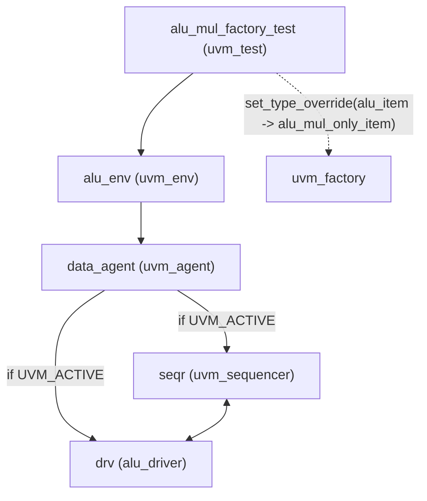

## 4.1 Why Encapsulate Into `uvm_agent` and `uvm_env`?

Putting `seqr` and `drv` directly inside `alu_minimal_test` (Chapter 3) works for 1 test, but fails the moment you need:
1. **A second interface** (e.g., an APB bus alongside our data port),
2. **Dozens of tests** that share the same structural wiring without copy-pasting `build_phase()`/`connect_phase()`,
3. **Passive SoC reuse**, where the driver and sequencer must be disabled (`UVM_PASSIVE`).



---

## 4.2 Configuration Objects Beat Scattered `config_db` Calls

Instead of storing 10 separate scalar fields in `uvm_config_db` (slow string lookups, typo risks), we bundle related settings inside `uvm_object` subclasses (`alu_agent_cfg`, `alu_env_cfg` in **`alu_cfg.sv`**):
- `alu_base_test` creates `env_cfg`, populates `env_cfg.data_agent_cfg.vif`, and passes `env_cfg` down to `alu_env`.
- `alu_env` passes `cfg.data_agent_cfg` down to `data_agent`.
- `alu_agent` inspects `cfg.is_active`: when `UVM_ACTIVE`, it builds `seqr` and `drv`.

---

## 4.3 Polymorphism Without Editing Code: `uvm_factory`

Notice in `alu_seq.sv` line 21:
```systemverilog
req = alu_item::type_id::create($sformatf("req_%0d", i));
```
Never call `new()` for reusable UVM items or components! Because the sequence asks the **Factory** to create `alu_item`, our derived test `alu_mul_factory_test` can execute:
```systemverilog
alu_item::type_id::set_type_override(alu_mul_only_item::get_type());
```
Every sequence automatically generates `alu_mul_only_item` (constrained to `ALU_MUL`) **without modifying a single line of `alu_seq.sv` or `alu_env.sv`**.
