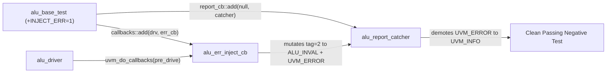

## 8.1 Extending Locked VIPs with `uvm_callback`

When verifying with third-party or shared company VIPs, **you must not edit the VIP driver** just to inject one protocol glitch or corrupt a specific packet tag.

In **`alu_driver.sv`**, two macro lines expose an extensible hook:
1. `` `uvm_register_cb(alu_driver, alu_driver_cb) `` inside the class declaration.
2. `` `uvm_do_callbacks(alu_driver, alu_driver_cb, pre_drive(this, req)) `` right before driving pins.

If zero callbacks are registered, `` `uvm_do_callbacks `` is a zero-cost no-op. When `+INJECT_ERR=1` is passed on the simulator command line, `alu_base_test` attaches **`alu_err_inject_cb`** to mutate `tag == 2` into `ALU_INVAL`!

---

## 8.2 Negative Testing & `uvm_report_catcher`

Error-injection tests intentionally trigger error messages (`ALU_ERR_INJ`). If left at `UVM_ERROR`, regression scripts mark the simulation as **FAILED**.
**`alu_report_catcher`** intercepts every report before it reaches the console:
- Matches `get_severity() == UVM_ERROR && get_id() == "ALU_ERR_INJ"`,
- Calls `set_severity(UVM_INFO)` and prepends `"[CAUGHT & DEMOTED] "`,
- Returns `THROW` (so any chained catchers still run) while letting real unexpected bugs fail loudly!
