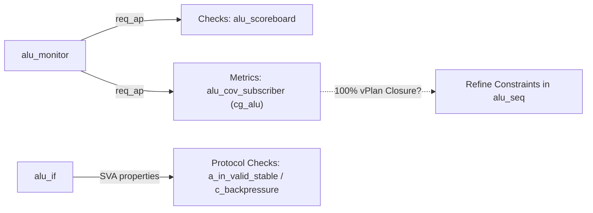

## 6.1 Closing the Loop: Coverage-Driven Verification (CDV)

Having a Scoreboard tells us *"no bugs observed on the tests we ran"*—but it never answers **"did we actually test all corner cases?"**
That is the role of **Metrics**:
1. **Code Coverage** (line, branch, toggle, FSM) collected by the simulator—answers *did every line of RTL execute?*
2. **Functional Coverage** (`covergroup` in **`alu_cov_subscriber.sv`**)—answers *did every feature and cross-product from the vPlan occur?*



---

## 6.2 `uvm_subscriber` & Cross Coverage

Extending `uvm_subscriber #(alu_item)` gives us `analysis_export` automatically—all we implement is `write(alu_item t)` calling `cg_alu.sample()`.

Notice how **`cx_op_x_err: cross cp_op, cp_err`** tracks every combination of operation and error flag, while `ignore_bins` excludes structurally impossible cases (such as `ALU_INVAL` producing `err_flag == 0`) so our target remains an honest **100%**.

---

## 6.3 Pin-Level Temporal Protocol Checking with SVA

Scoreboards operate at **transaction level**—they are terrible at catching single-cycle glitch violations like changing `a` or `op` while `in_valid && !in_ready`.
Concurrent **SystemVerilog Assertions (SVA)** belong directly inside **`alu_if.sv`**:
```systemverilog
property p_in_valid_stable;
  @(posedge clk) disable iff (!rst_n)
  (in_valid && !in_ready) |=> (in_valid && $stable({op, a, b, tag}));
endproperty
a_in_valid_stable: assert property (p_in_valid_stable);
```
Now Stimuli (`driver`/`seq`), Checks (`scoreboard` + `SVA`), and Metrics (`cov_subscriber` + `cover property`) are **100% decoupled and modular**.
