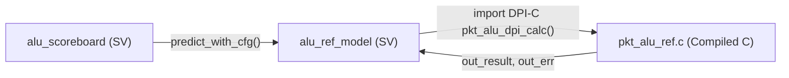

## 12.1 Zero-Copy Golden Modeling with SystemVerilog DPI-C

Complex DSP, crypto, or AI accelerators already have **gold-standard C/C++ models** written by the Architecture team. Re-coding those algorithms in SystemVerilog invites transcription bugs.
Using **Direct Programming Interface (DPI-C)** (`pkt_alu_dpi_pkg.sv` + `c_model/pkt_alu_ref.c`), `alu_ref_model` invokes compiled C functions directly at native speed:

Notice in `Makefile.questa`, simulators compile `.c` files directly alongside `.sv` without manual PLI/VPI wrappers!

---

## 12.2 Vertical Reuse: From IP Block to Full SoC (`soc_subsys_env.sv`)

Remember **Chapter 1's V-Cycle** and **Chapter 2's Separation of Concerns**? Because we never put checks in the driver or metrics in the sequence, **`soc_subsys_env`** instantiates `block_alu_env` inside a chip-level testbench:
- When a CPU or DMA master on the SoC now drives `pkt_alu`, setting `passive_reuse_mode = 1` switches `data_agent` and `apb_agt` to **`UVM_PASSIVE`**.
- The drivers and sequencers disappear automatically—while **`alu_monitor`**, **`uvm_reg_predictor`**, **`alu_scoreboard` (with DPI-C C model)**, **`alu_cov_subscriber`**, and **SVA assertions** continue checking 100% of chip traffic unchanged!
