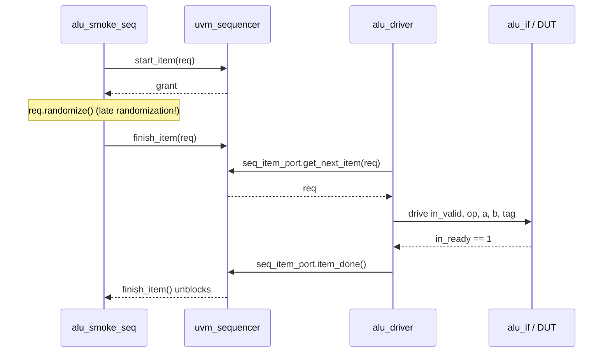

## 3.1 Stripping UVM Down to Pure Stimuli

Many beginners feel overwhelmed because tutorials throw `agent`, `env`, `factory`, `scoreboard`, and `RAL` at them on page 1. Here, we **intentionally start with zero checking and zero containers**: just the **5 essential stimuli pieces** wired inside `alu_minimal_test`.

---

## 3.2 Anatomy of Every File in This Minimal Environment

1. **`alu_if.sv` (Physical & Clocking Bridge):**
   Wraps the wires connecting `tb_top` and `pkt_alu_basic`. Using a `clocking drv_cb @(posedge clk)` prevents SystemVerilog race conditions between RTL `always_ff` and testbench assignments.
2. **`alu_item.sv` (The Transaction):**
   Extends `uvm_sequence_item` (which inherits from `uvm_object`, *not* `uvm_component`—items are transient data created dynamically during simulation). Registers with `` `uvm_object_utils_begin `` and defines `rand` properties + constraints (`c_valid_op`, `c_operand_range`).
3. **`alu_seq.sv` (The Stimulus Recipe):**
   Extends `uvm_sequence #(alu_item)`. In `body()`, each item uses **late randomization**:
   - `start_item(req)` waits until the sequencer grants bus access,
   - `req.randomize()` solves constraints right when the driver is ready,
   - `finish_item(req)` hands the item to the driver and blocks until `item_done()`.
4. **`alu_driver.sv` (The Pin Wiggler):**
   Extends `uvm_driver #(alu_item)`. In `build_phase()`, it fetches `virtual alu_if vif` from `uvm_config_db`. In `run_phase()`, an infinite `forever` loop pulls items via `seq_item_port.get_next_item(req)`, drives the `Valid/Ready` handshake, and calls `seq_item_port.item_done()`.
5. **`alu_minimal_test.sv` & `tb_top.sv` (Wiring & Objections):**
   - `tb_top` instantiates `pkt_alu_basic` + `alu_if`, publishes `u_alu_if` into `uvm_config_db`, and calls `run_test("alu_minimal_test")`.
   - `alu_minimal_test` creates `seqr` and `drv`, connects `drv.seq_item_port.connect(seqr.seq_item_export)`, and wraps `seq.start(seqr)` inside **`phase.raise_objection(this)` / `phase.drop_objection(this)`**—without an objection, `run_phase` exits immediately at `0 ns`!
