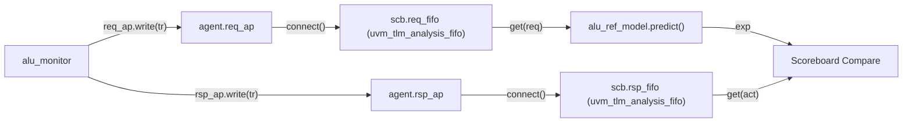

## 5.1 Passive Observation via `uvm_monitor`

Until Chapter 4, our testbench could drive pins—but it was **blind** to whether the DUT computed the right answer!

In **`alu_monitor.sv`**, we fork two independent passive loops reading `vif.mon_cb`:
1. **`collect_requests()`:** Watches `in_valid && in_ready`. Whenever an input handshake succeeds, it constructs an `alu_item` and calls `req_ap.write(tr)`.
2. **`collect_responses()`:** Watches `out_valid && out_ready`. Whenever the DUT produces an output, it constructs an `alu_item` with `out_tag`, `result`, `err_flag` and calls `rsp_ap.write(tr)`.

> **Why sample inputs via the monitor instead of taking them from the driver?**
> Because in a multi-master or SoC environment (`UVM_PASSIVE`), our driver doesn't even exist—yet the monitor still sees every input transaction accepted by the DUT!

---

## 5.2 Decoupled Broadcasting with `uvm_analysis_port` & `uvm_tlm_analysis_fifo`



A `uvm_analysis_port` is **non-blocking** (0-time `write()`). If the scoreboard needs to wait for *both* an input request and a 1-cycle-later DUT output before comparing them, we buffer incoming broadcasts inside **`uvm_tlm_analysis_fifo #(alu_item)`**, then pull matching pairs inside `alu_scoreboard::run_phase()` using blocking `req_fifo.get(req)` and `rsp_fifo.get(act)`.

---

## 5.3 End-of-Test Hygiene in `check_phase()`

What if the DUT dropped the last packet and never asserted `out_valid`? If you only compare pairs inside `run_phase()`, a dropped packet hangs silently!
That's why `alu_scoreboard::check_phase()` verifies:
```systemverilog
if (!req_fifo.is_empty() || !rsp_fifo.is_empty())
  `uvm_error("SCB", "Unmatched items remaining at end of test!")
```
