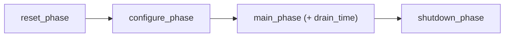

## 9.1 Structuring Execution Across Run-Time Sub-Phases

In complex SoC testbenches, placing reset waiting, register configuration, main traffic, and end-of-test drain all inside a single `run_phase()` turns tests into tangled spaghetti. UVM splits `run_phase` in parallel with **12 fine-grained run-time sub-phases**—most importantly:

In **`alu_test.sv`**:
- **`reset_phase`**: waits for `rst_n == 1` before any configuration runs.
- **`configure_phase`**: programs `SAT_LIMIT` over APB *before* datapath sequences start.
- **`main_phase`**: executes `alu_virtual_seq`, activates **`uvm_heartbeat`**, and sets `phase.phase_done.set_drain_time(this, 20ns)`.
- **`shutdown_phase`**: cleanly drains final pipelined packets and performs end-of-test register checks.

---

## 9.2 Synchronization Primitives & `uvm_heartbeat`

1. **`uvm_event_pool` & `uvm_barrier` (`alu_virtual_seq.sv`):**
   - `uvm_event_pool::get_global_pool().get("cfg_done")` lets any monitor, sequence, or scoreboard wait on named milestones without global variable spaghetti.
   - `uvm_barrier("sync_bar", 2)` guarantees `seq_a` and `seq_b` hit the starting gate together before competing on `alu_sqr`.
2. **`uvm_domain` (`alu_env.sv`):**
   - Isolates `apb_agt` inside `apb_domain`, synchronized in lockstep with `uvm_domain::get_common_domain()` via `apb_domain.sync(...)`—ready for multi-reset SoCs!
3. **`uvm_heartbeat`:**
   - Watches registered components (`data_agent.drv`). If a bus deadlock prevents `hb_obj` activity between two `hb_trig` triggers, UVM immediately terminates with `UVM_FATAL [HBFAIL]` instead of burning hours of compute!
