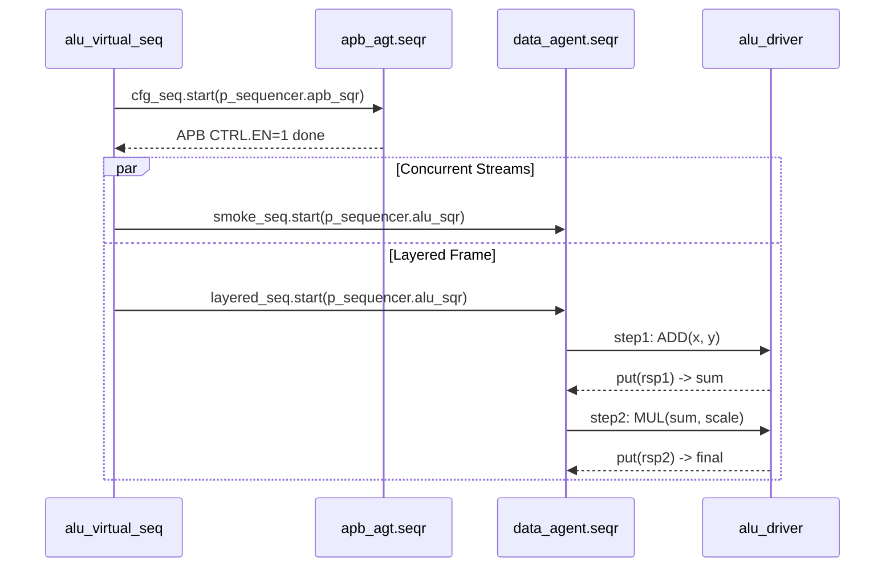

## 7.1 Upgrading to a Multi-Interface DUT (`pkt_alu.sv`)

Real hardware almost always has **at least two buses**: a **Control/Register interface** (here APB3) and a **Datapath interface** (`Valid/Ready`). Driving them independently without coordination causes race conditions (e.g., sending packets before configuring saturation registers).



---

## 7.2 Tagged Driver Responses & Layered Sequences

Look at **`alu_driver.sv`**: instead of `get_next_item()`/`item_done()`, we use `seq_item_port.get(req)` and return a response via:
```systemverilog
rsp.set_id_info(req); // Copies transaction_id & sequence_id so sequencer routes rsp to the right thread!
seq_item_port.put(rsp);
```
Because **`alu_layered_frame_seq`** (`alu_seq.sv`) receives `rsp1` via `get_response(rsp1)`, it can feed the hardware result of `(x + y)` directly into the second transaction `MUL(sum, scale)`!

---

## 7.3 Virtual Sequencer & Virtual Sequences

A **Virtual Sequencer** (`alu_virtual_sequencer`) drives **zero pins of its own**. It simply holds typed handles to sub-sequencers (`alu_sqr`, `apb_sqr`) connected in `alu_env::connect_phase()`.
Inside **`alu_virtual_seq`**, `` `uvm_declare_p_sequencer(alu_virtual_sequencer) `` creates a strongly-typed `p_sequencer` handle so one test scenario orchestrates APB configuration followed by parallel data streams.
