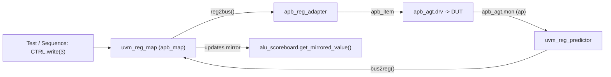

## 10.1 Why RAL Eliminates Raw Address Hardcoding

Writing `addr = 8'h08; data = 32'h800;` across 200 tests breaks immediately if a register moves from `0x08` to `0x14`.
With **UVM RAL (`pkt_alu_reg_block.sv`)**, tests write intent symbolically:
```systemverilog
env.reg_model.SAT_LIMIT.write(status, 32'h0000_0800, UVM_FRONTDOOR);
```



---

## 10.2 Explicit Prediction & Backdoor Access

1. **Explicit Prediction (`set_auto_predict(0)`):** Every bus access observed by `apb_monitor` enters `reg_predictor.bus_in`, converts back via `apb_reg_adapter::bus2reg()`, and updates the RAL **mirrored value**—even if another bus master (not RAL!) wrote the register.
2. **Frontdoor vs. Backdoor:** `UVM_FRONTDOOR` cycles real APB pins (`psel`/`penable`); `UVM_BACKDOOR` (`peek()`/`poke()` via `add_hdl_path("tb_top.u_dut")`) reads RTL signals directly in **0 simulation time**.
3. **Built-in Register Tests:** `uvm_reg_hw_reset_seq` automatically sweeps every register in `apb_map` and checks its hardware reset value!
