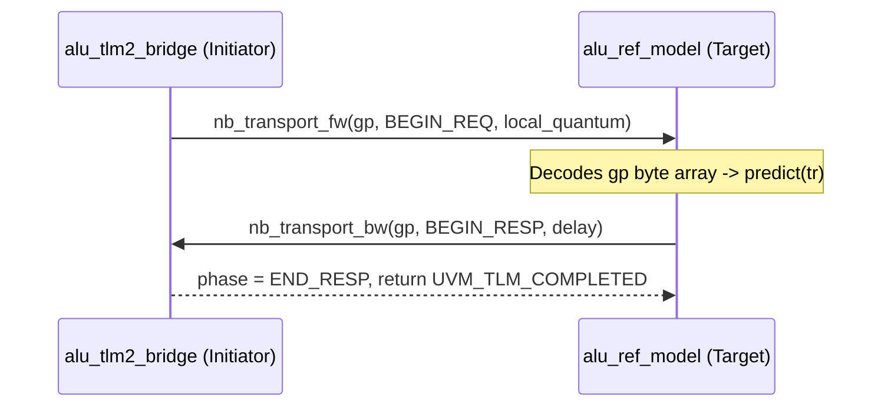

## 11.1 TLM-1 vs. TLM-2.0: When Do You Need Sockets?

TLM-1 (`uvm_analysis_port`, `uvm_tlm_fifo`) excels inside UVM testbenches, whereas **TLM-2.0** mirrors the IEEE 1666 SystemC standard so SystemVerilog models interoperate seamlessly with fast C++/SystemC architectural simulators:

| Feature | TLM-1 | TLM-2.0 |
| :--- | :--- | :--- |
| **Connection** | Separate `port` + `export` + `imp` | Single **Bidirectional Socket** (`connect()` wires both FW & BW paths!) |
| **Payload** | Custom `uvm_sequence_item` | Standard **`uvm_tlm_generic_payload`** (addr, command, byte array, response status) |
| **Timing** | Untimed / blocking tasks | **Temporal Decoupling** (`uvm_tlm_time` quantum) & 4-phase AT protocol |

---

## 11.2 4-Phase Non-Blocking Handshake & Temporal Decoupling

In **`alu_tlm2_bridge.sv`**, each monitored `alu_item` is serialized into `uvm_tlm_generic_payload`, increments `local_quantum` by `5ns`, and dispatches `nb_init_socket.nb_transport_fw(...)` directly to `alu_ref_model.nb_target_socket`.
