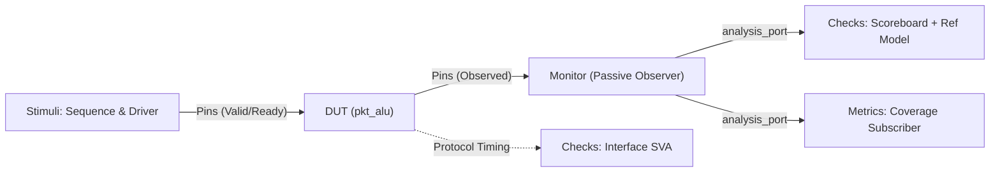

## 2.1 The Three Pillars: Stimuli, Checks, and Metrics

Before writing a single line of UVM code, internalize the **Separation of Concerns** that makes a UVM testbench reusable from block level all the way to SoC:

1. **Stimuli (What we inject):** `uvm_sequence_item`, `uvm_sequence`, `uvm_sequencer`, and `uvm_driver`. Their *only* job is to generate valid (or intentionally stressed/faulty) transactions and translate them to interface pins. **A driver must never decide whether the DUT passed or failed.**
2. **Checks (Is the DUT right?):** Interface **SVA** (pin-level protocol rules), passive **`uvm_monitor`** observers, a golden **Reference Model**, and **`uvm_scoreboard`**. Checkers observe *actual* pin activity passively—so they still work identically even when another master drives the DUT in an SoC (`UVM_PASSIVE` mode!).
3. **Metrics (Are we done yet?):** **`uvm_subscriber`** functional `covergroup`s, cover properties, and code coverage. Metrics observe *what actually crossed the DUT boundary* (not just what a sequence asked for!) so we know when the vPlan is truly closed.

---

## 2.2 Transaction-Level Modeling (TLM) vs. Pin-Wiggling

Legacy Verilog testbenches mixed everything inside `initial` blocks (`@(posedge clk); valid = 1; if (result !== 5) $error...`). That breaks immediately when protocols change or blocks integrate into larger chips.

UVM introduces two clean abstraction boundaries:
- **Above the Driver/Monitor:** Components exchange **SystemVerilog transaction objects** (`alu_item` with fields `op`, `a`, `b`, `tag`) over TLM ports. Sequences never toggle clock edges.
- **At the Virtual Interface:** Only the `uvm_driver` and `uvm_monitor` know about `clk`, `rst_n`, `in_valid`, `in_ready`, and clocking blocks.

---

## 2.3 Why Avoid Anti-Patterns?

| Anti-Pattern | What Breaks? | UVM Principle Violated |
| :--- | :--- | :--- |
| Checking DUT results inside `uvm_driver` | Fails completely in `UVM_PASSIVE` subsystem reuse when external RTL drives the bus. | Mixing **Stimuli** and **Checks** |
| Sampling `covergroup` inside `uvm_sequence` | Measures requested items, not what actually passed handshakes or survived callbacks/arbitration. | Mixing **Stimuli** and **Metrics** |
| Hardcoding `tb_top.u_dut.sig` in tests | Breaks hierarchy encapsulation and prevents running multiple instances in an SoC. | Violating **TLM & Virtual Interface** isolation |

---

## 2.4 Meet Our Running Example: `pkt_alu`

Throughout Chapters 3–13 we will verify **`pkt_alu`**, a realistic Packet-ALU IP built in two stages:
- **Chapters 3–6 (`pkt_alu_basic.sv`):** Streaming `Valid/Ready` input (`op`, `a`, `b`, `tag`) and output (`result`, `out_tag`, `err_flag`) with 1-cycle latency.
- **Chapters 7–13 (`pkt_alu.sv` + `pkt_alu_ref.c`):** Adds an **APB3 Register Interface** (`CTRL`, `STATUS`, `SAT_LIMIT`, `PKT_COUNT`, `ERR_INJECT`) for multi-agent virtual sequences, RAL register verification, TLM-2 sockets, and a compiled C/DPI-C golden reference model.
