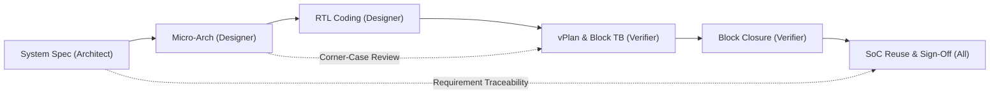

## 1.1 Why Verification Exists (And Why Designers Don't Verify Their Own RTL)

In modern ASIC and FPGA projects, **verification typically accounts for 60% to 70% of engineering time and compute resources**. The objective is fundamentally asymmetric compared to hardware design:

- **RTL Design** builds a *specific* hardware micro-architecture that satisfies timing, area, and power budgets.
- **Functional Verification** tries to *break* that implementation under every legal (and illegal) sequence of inputs, corner cases, backpressure stalls, and register configurations before tape-out.

> **Golden Rule of Independent Verification:** Never verify a block solely using the same mental assumptions used to design it. If a designer misreads an ambiguous sentence in a specification, writing both the RTL and the testbench perpetuates the exact same bug in both places.

---

## 1.2 The Hardware V-Cycle

The **V-Cycle** models how abstraction descends from system requirements down to synthesizable SystemVerilog RTL (left leg), and then climbs back up through block, subsystem, and SoC verification to tape-out sign-off (right leg).

Each descending step creates a **specification contract**, and each ascending step validates that contract independently:

1. **System Specification -> Verification Plan (vPlan):** Every architectural requirement (e.g., *"saturate arithmetic overflow when `CTRL.SAT_EN=1`"*) receives a unique requirement ID mapped to stimulus scenarios, assertions, and coverage bins.
2. **Micro-Architecture -> Corner-Case Checklist:** Pipeline hazards, FIFO full/empty transitions, reset synchronization, and bus wait-states are translated into constrained-random constraints and SVA properties.
3. **RTL Freeze -> Block UVM Verification:** Once port lists and protocols stabilize, the Verification Engineer exercises the DUT inside an automated self-checking UVM testbench.
4. **Block Closure -> Subsystem / SoC Vertical Reuse:** Clean UVM environments switch their block agents from `UVM_ACTIVE` to `UVM_PASSIVE` so the exact same scoreboard and coverage collectors keep checking inside full-chip simulations.

---

## 1.3 Role Split: Architect vs. Designer vs. Verifier

| Responsibility | System Architect | RTL Designer | Verification Engineer |
| :--- | :--- | :--- | :--- |
| **Primary Artifact** | System Spec, Memory/Register Map (IP-XACT), Interface Specs | Synthesizable RTL (`pkt_alu.sv`), Lint/CDC-clean code | vPlan, UVM Testbench, Reference Model, Coverage & Sign-off Report |
| **Mental Model** | *What* the IP must do externally (protocols, throughput, registers) | *How* silicon implements it cycle-by-cycle (FSMs, flops, muxes) | *How it could fail* (races, stalls, overflow, reset, illegal sequences) |
| **Interface Ownership** | Defines bus protocol & register reset values | Implements RTL pins & timing constraints | Writes `interface` + SVA assertions + BFM Driver/Monitor |
| **Debug Ownership** | Resolves spec ambiguities | Fixes confirmed RTL bugs & updates waveforms | Triages failures, distinguishes TB vs RTL bugs, closes coverage holes |
| **Sign-Off Gate** | Confirms architectural intent | Confirms synthesis/lint/CDC clean | Confirms 0 errors, 100% functional + code coverage closure |

Explore the **Interactive V-Cycle & Role Matrix** below to inspect every stage, deliverable, and handoff contract.
